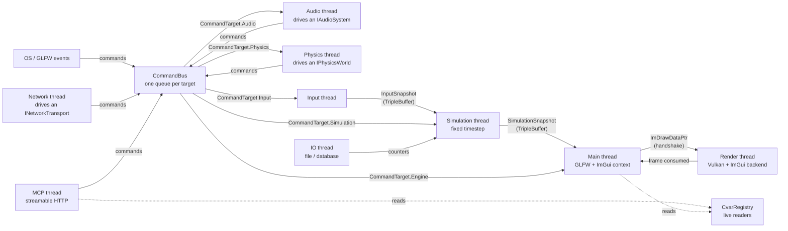
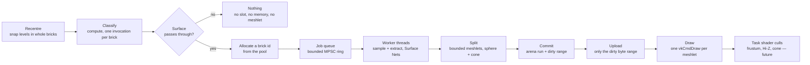
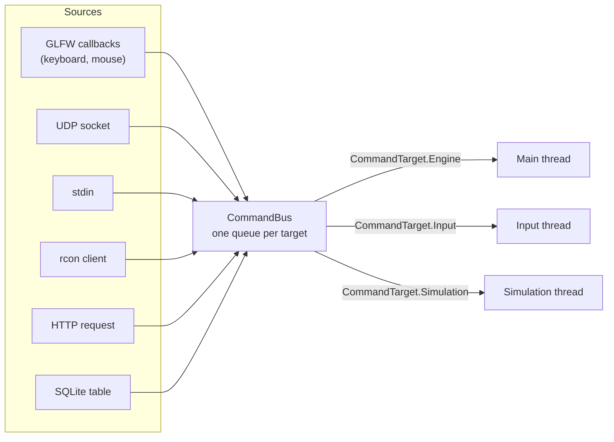
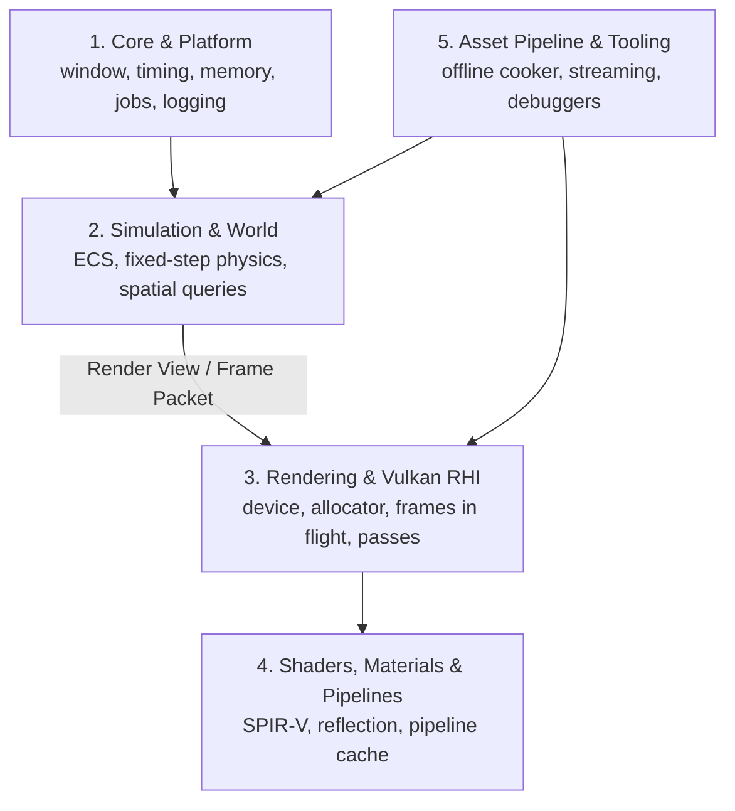

# Brutal Test Engine

A minimal .NET 10 game engine built on the [BRUTAL](https://github.com/ahwootech/BRUTAL) framework.
It opens a GLFW window, renders a triangle with Vulkan, and draws a Dear ImGui debug panel over it.
The simulation runs on a fixed timestep on its own thread, with input, IO and networking each on a
thread of their own. It is written data-oriented, and it exposes its live state to a machine over MCP
as well as to a person through the debug panel.

The solution has three projects: the engine library, a deliberately blank game that hosts it, and a
unit-test project. The engine owns no entry point — see [Layout](#layout).

BRUTAL is a framework, not an engine: it supplies the low-level pieces (windowing, Vulkan and ImGui
bindings) and leaves the architecture to you. This repository is one small architecture on top of it.

## Documentation

> **[github.com/ahwootech/BRUTAL](https://github.com/ahwootech/BRUTAL) is the source of truth for
> everything about BRUTAL** — its API surface, samples, licensing and release notes. Where this
> README and the BRUTAL repository disagree, BRUTAL wins.

Nothing here replaces that repository, and no copy of its documentation is vendored into this
project. Use these sources alongside it:

| Source | What it covers |
| --- | --- |
| [BRUTAL repository](https://github.com/ahwootech/BRUTAL) | Canonical docs: API reference, samples and guidance for every `Brutal.*` library. |
| [ahwoo.com/brutal](https://ahwoo.com/brutal) | Project home page and licensing overview. |
| [BRUTAL licence](https://github.com/ahwootech/BRUTAL/blob/main/LICENSE.txt) | Terms and the attribution obligations for shipped products. |
| [NuGet package pages](https://www.nuget.org/packages?q=Ahwoo.BRUTAL) | Per-package versioning for the `Ahwoo.BRUTAL.*` packages this project references. |
| This README | Only what is specific to this repository: engine layout, how a frame is built here, the threading model, and the architecture we are growing towards. |
| [Vulkan specification](https://registry.khronos.org/vulkan/specs/latest/html/vkspec.html) and [Vulkan Samples](https://docs.vulkan.org/samples/latest/README.html) | The API semantics underneath BRUTAL's Vulkan bindings. |

Because BRUTAL is deliberately a framework rather than an engine, it documents the pieces it hands
you — not a scene graph, render graph or asset pipeline. Those are ours to design, and the
[Architecture](#architecture) section below is the shape this engine is aiming for.

## Use BRUTAL's types, don't reinvent them

This repository is a thin architecture on top of BRUTAL. It is **not** a place to reimplement what
the framework already provides.

**If BRUTAL exposes a type, class or API for something, use it.** Do not hand-roll a private
equivalent in this repo — no parallel math structs, no second Vulkan wrapper, no home-grown GLFW
binding. Concretely:

- **Math types:** use `Brutal.Numerics` (`int2`, `float2`, `float4`, matrices, `ByteSize32`,
  `ByteSize64`, …) — not `System.Numerics` and not custom vector structs.
- **Vulkan:** go through `Brutal.VulkanApi`, `Brutal.VulkanApi.Abstractions` and
  `Brutal.VulkanApi.Vma` — `Instance`, `DeviceEx`, `Queue`, `CommandBuffer`, `VmaAllocator` and
  friends. Don't add our own P/Invoke bindings or call `vk*` entry points directly.
- **Windowing and input:** use `Brutal.GlfwApi`, not another GLFW wrapper.
- **Strings and logging:** use `Brutal.Strings` (`Utf8`, `ImString`) and `Brutal.Logging`
  (`LogCategory`) for engine logs. Serilog is the sink pipeline underneath `LogSystem`, not a
  replacement for it — see [Logging](#logging).
- **Shader compilation:** use `Brutal.ShaderCApi`, not an external `glslc` invocation.
- **ImGui:** use `Brutal.ImGuiApi` and `Brutal.ImGuiApi.Backends`, not raw bindings.
- **GPU capture:** use `Brutal.RenderDocApi` (`RenderDoc`, and `RenderDocWindow` for the panel), not a
  hand-written ABI table — see [GPU capture](#gpu-capture-trace-labels-renderdoc-and-tracy).
- **Networking:** use `Brutal.RakNetApi` (`RakPeerInstance`, `RakPeerInterface`), not another transport
  library — see [Networking](#networking).
- **Physics:** use `Brutal.JoltApi` (`PhysicsSystem`, `BodyInterface`), not another physics library — see
  [Physics](#physics).
- **Audio:** use `Brutal.FmodApi` (`Fmod`, `FmodSystem`), not another audio library — see [Audio](#audio).

What *is* ours is the architecture: the layering, the loop, ownership and lifetime policy, and the
gameplay/world code. Even there, reach for framework primitives first and write new code only where
BRUTAL deliberately leaves a gap — which is the entire point of a framework.

BRUTAL ships far more than the subset this project currently references, so before writing anything
non-trivial, check the [BRUTAL repository](https://github.com/ahwootech/BRUTAL) for an existing
library. For example: `Brutal.Box2D` for 2D physics, `Brutal.Gltf`/`Brutal.Ktx`/`Brutal.MeshOptimizer`
for assets and meshes, `Brutal.Concurrency` for jobs, `Brutal.Memory` for allocators,
`Brutal.Monitor.*` for diagnostics. Adding a package reference to an existing `Ahwoo.BRUTAL.*` library
beats writing our own.

This is not theoretical — it caught a real duplication. RenderDoc support was originally hand-rolled
here, complete with a copy of the `RENDERDOC_API_1_7_0` table, because `Ahwoo.BRUTAL.RenderDoc` had not
been spotted. The fix was to delete the wrapper's ABI and keep only the timing decision that belongs to
a host. When in doubt, list the packages before writing the code:

```bash
curl -s "https://azuresearch-usnc.nuget.org/query?q=Ahwoo.BRUTAL&take=100" \
  | jq -r '.data[].id' | sort
```

Currently referenced: `Ahwoo.BRUTAL.Core`, `.Fmod`, `.Glfw`, `.ImGui`, `.ImGui.Backends`, `.Jolt`,
`.Logging`, `.Memory`, `.Numerics`, `.RakNet`, `.RenderDoc`, `.RenderDoc.ImGui`, `.ShaderC`, `.Strings`,
`.Vulkan`, `.Vulkan.Abstractions` and `.Vulkan.Vma` — see
[BrutalTestEngine.csproj](src/BrutalTestEngine/BrutalTestEngine.csproj). They are referenced by the
engine library only, so a game inherits them by referencing the engine once.

## What it does

- Creates a resizable GLFW window with no OpenGL context (`GLFW_NO_API`), ready for Vulkan.
- Sets up a Vulkan 1.3 instance, surface, device, swapchain, render pass and per-frame
  synchronisation.
- Rebuilds the swapchain whenever the framebuffer size changes, and can switch between a windowed
  and a borderless-fullscreen window.
- Compiles two inline GLSL shaders at runtime with ShaderC and draws a coloured triangle from a
  VMA-allocated vertex buffer.
- Runs compute passes through a small abstraction — a compiled shader, a typed buffer and a pipeline that
  owns its descriptor set — and verifies each one by reading its output back and comparing it against a CPU
  reference — see [Compute shaders](#compute-shaders).
- Builds the world as an SDF brick-clipmap, extracts each surface brick's geometry with Surface Nets and
  splits it into GPU meshlets with bounding spheres and normal cones, classifying bricks on the GPU and
  verifying that pass against its CPU reference per brick — see
  [The world](#the-world-sdf-brick-clipmaps-and-gpu-meshlets).
- Runs Dear ImGui with the GLFW and Vulkan backends, recording its draw lists into the same render
  pass so the debug panel composites over the scene.
- Shows frame time, FPS, framebuffer size and the Vulkan device name, with a toggle for the ImGui
  demo window.
- Switches between windowed and borderless fullscreen from the debug panel's radio buttons or with
  <kbd>F11</kbd>.
- Runs the simulation on a fixed timestep on its own thread, decoupled from the frame rate, with
  input, IO and networking each on a thread of their own.
- Routes every intent — keyboard, mouse, network, console, remote console, web and database — through
  one threaded command queue, with an in-engine console panel that shows the live command stream.
- Logs through BRUTAL's `LogCategory` primitive into a Serilog pipeline with a bounded asynchronous
  sink, so a log call in a hot loop allocates nothing when disabled and never blocks the caller.
- Shows that stream in an ImGui log window with level, category and text filters, where input events sit
  at the lowest level so they never bury anything else — see [The log window](#the-log-window).
- Emits Vulkan debug labels for GPU capture, routes validation messages into the log, and can trigger
  a RenderDoc frame capture over any transport — all optional, and all no-ops when the tools are
  absent.
- Runs on an `INetworkTransport` seam over RakNet by default, so the networking library is a choice
  rather than a commitment.
- Runs physics on its own thread behind an `IPhysicsWorld` seam, with a Jolt backend written against
  BRUTAL's binding.
- Runs audio on its own thread behind an `IAudioSystem` seam, with an FMOD backend.
- Stores simulation entities in a struct-of-arrays store and steps them with flat, allocation-free
  array passes — see [Data-oriented design](#data-oriented-design).
- Exposes every engine variable and the whole command grammar over MCP on its own thread, so a client
  can inspect and drive a running engine as data rather than through screenshots — see
  [MCP](#mcp-live-inspection-for-a-machine).

Pressing <kbd>Escape</kbd> closes the window.

## Prerequisites

- [.NET 10 SDK](https://dotnet.microsoft.com/download) — the BRUTAL packages target `net10.0` only.
- A Vulkan 1.3 capable GPU with current drivers. Vulkan arrives with your GPU driver on Windows.
- Optional: the [Vulkan SDK](https://vulkan.lunarg.com/) for validation layers. Pass `--validate` to
  enable them when they are installed.

## Running

```sh
dotnet run --project src/BrutalTestEngine.Game
```

Options:

| Argument | Description |
| --- | --- |
| `--frames=N` | Render `N` frames then exit instead of running until the window closes. |
| `--tick-rate=HZ` | Simulation ticks per second (default `60`). Independent of the frame rate. |
| `--log=LEVEL` | Log level: `verbose`, `debug`, `information`, `warning`, `error` or `fatal`. |
| `--log-file=PATH` | Also write rolling daily log files to `PATH` (7 files retained). |
| `--validate` | Enable the Vulkan validation layer *and* debug tracing. |
| `--trace` | Enable Vulkan debug labels for GPU capture, without validation layers. |
| `--renderdoc` | Enable RenderDoc in-application capture when RenderDoc is attached. |
| `--captures=DIR` | Where RenderDoc writes captures (default: RenderDoc's own setting). |
| `--physics` | Enable the Jolt physics world. Off by default while BRUTAL's binding faults on step. |
| `--no-audio` | Do not open an audio device. |
| `--fullscreen` | Start in borderless fullscreen instead of a windowed window. |
| `--web=PORT` | Listen for commands as HTTP requests on `127.0.0.1:PORT`. |
| `--mcp=PORT` | Serve the MCP server on `127.0.0.1:PORT`, exposing every engine variable. |
| `--database=PATH` | Poll a SQLite database at `PATH` for commands. |
| `--selftest` | Drive every command source, verify the results, then exit. |
| `--help` | Print usage. |

`--frames` is there so the whole startup, render and shutdown path can be exercised without a human
closing the window:

```sh
dotnet run --project src/BrutalTestEngine.Game -- --frames=120 --validate
```

`--tick-rate` is there to prove the simulation is not tied to the frame rate. The same frame count
produces a different tick count as the rate changes:

```sh
dotnet run --project src/BrutalTestEngine.Game -- --frames=180 --tick-rate=30   # ~51 ticks
dotnet run --project src/BrutalTestEngine.Game -- --frames=180 --tick-rate=240  # ~300 ticks
```

## Layout

The engine is a library. It owns no entry point and no process; a *game* project references it and
supplies `Main`. That split is deliberate: a seamless-world server and a client are two different hosts
over one authoritative simulation, so the engine cannot be allowed to assume it is an application.

```
BrutalTestEngine.slnx
.vscode                        editor setup: MCP registration, tasks and launch profiles
src/BrutalTestEngine           the engine library (net10.0, OutputType=Library)
├── Engine
│   ├── EngineOptions.cs       title, size, frame limit, tick rate, tracing, transport, capture
│   ├── Engine.cs              lifecycle, thread ownership and the main-thread frame loop
│   ├── Window.cs              GLFW lifetime, the window itself, windowed/fullscreen modes
│   ├── WindowMode.cs          windowed or borderless fullscreen
│   ├── VulkanRenderer.cs      instance, device, swapchain, render pass, triangle pipeline, debug labels
│   ├── VulkanDebugMessenger.cs routes validation/debug-utils messages into the log
│   ├── RenderDocCapture.cs    RenderDoc's in-application API, via BRUTAL's binding
│   ├── SwapchainState.cs      everything rebuilt when the swapchain is recreated
│   ├── RenderTargetImage.cs   a captured frame, and its PNG encoding
│   ├── PngEncoder.cs          a minimal PNG writer, so a capture needs no imaging library
│   ├── RenderThread.cs        the render thread and the main↔render frame handshake
│   ├── ImGuiVulkanRenderer.cs the ImGui Vulkan backend, owned by the render thread
│   ├── DebugUi.cs             ImGui context, GLFW backend and the debug panel (main thread)
│   ├── CommandSelfTest.cs     drives every command source end to end and reports the result
│   ├── CvarRegistry.cs        the readable-variable registry the MCP server reads
│   ├── EngineStatus.cs        the one-call status summary the MCP server serves
│   ├── ThreadMetrics.cs       rolling per-thread latency statistics: last, mean, p99 and max
│   ├── ThreadTimerRegistry.cs one named metric per piece of work, shared by every thread
│   └── Vertex.cs              position + colour vertex
├── Logging
│   ├── EngineLog.cs           the Serilog pipeline behind BRUTAL's categories, and the named categories
│   ├── EngineLogOptions.cs    sinks, minimum level and the bounded async buffer size
│   ├── LogEventBuffer.cs      bounded ring buffer of recent events, for the debug window
│   └── LogEventSink.cs        feeds that buffer from the pipeline's background writer
├── Compute
│   ├── ComputeShader.cs       GLSL compiled to SPIR-V once, wrapped in a shader module
│   ├── ComputeBuffer.cs       a VMA allocation sized for T, with upload/download/mapped access
│   └── ComputePipeline.cs     descriptor set layout, pool, set, pipeline layout and pipeline, together
├── Threading
│   ├── MpscQueue.cs           multi-producer/single-consumer queue for inbound work
│   └── TripleBuffer.cs        lock-free single-writer/single-reader state handoff
├── Physics
│   ├── IPhysicsWorld.cs       the seam: create a body, read it, step the world
│   ├── JoltPhysicsWorld.cs    the Jolt backend, written against BRUTAL's binding
│   └── NullPhysicsWorld.cs    a world that does nothing and says so
├── Audio
│   ├── IAudioSystem.cs        the seam: initialize, update, report what is playing
│   ├── FmodAudioSystem.cs     the FMOD backend, and the missing-native-library path
│   └── NullAudioSystem.cs     a system that mixes nothing and says so
├── Commands
│   ├── Command.cs             the command abstraction, its sources and targets, and every command type
│   ├── CommandBus.cs          the concurrent per-target queues, sequencing, timing and logging
│   ├── CommandLog.cs          bounded ring buffer of recently accepted commands
│   ├── CommandParser.cs       the shared text grammar used by every text transport
│   ├── ICommandHandler.cs     the visitor that forces every consumer to handle every command type
│   └── KeyBindings.cs         maps a key to the intent it stands for, separately from its key state
├── Simulation
│   ├── SimulationThread.cs    fixed-timestep tick loop
│   ├── EntityStore.cs         struct-of-arrays entity storage: the data-oriented core
│   └── SimulationSnapshot.cs  immutable view of the simulation for other threads
├── World
│   ├── WorldSettings.cs       level count, brick shape and metric scale, and their bounds
│   ├── ClipmapLevel.cs        one ring: its metric, its anchor and integer slot addressing
│   ├── SdfClipmap.cs          the levels, the re-centring rule and the level-selection rule
│   ├── BrickKey.cs            a brick's identity: its level and its lattice coordinate
│   ├── SdfBrick.cs            the field block, its neighbour ring and the cell tables
│   ├── SurfaceNetExtractor.cs field block to mesh, watertight across brick boundaries
│   ├── BrickMesh.cs           the extracted mesh and the octahedral normal encoding
│   ├── MeshletBuilder.cs      mesh to bounded meshlets, with bounding spheres and cones
│   ├── MeshletArena.cs        the run-length GPU arena meshlets are packed into
│   ├── BrickShape.cs          the hardware budgets and the geometry bounds they imply
│   ├── SdfBrickPool.cs        the indirection table and the free list
│   ├── DirtyBrickSet.cs       which bricks need rebuilding, and the edit overlap query
│   ├── SdfBrickStore.cs       the CPU pipeline, from a clipmap slot to meshlets in the pools
│   ├── BrickClassifier.cs     the CPU reference for the GPU classification pass
│   └── TerrainField.cs        the demonstration terrain the self-test runs on
├── Input
│   ├── InputThread.cs         folds commands into a per-frame input snapshot
│   ├── InputCommands.cs       GLFW callback vocabulary → commands
│   ├── InputSnapshot.cs       key/button/cursor state for a frame
│   └── InputKeys.cs           key codes the engine understands, without a GLFW dependency
├── Host
│   ├── ConsoleCommandSource.cs reads commands from stdin on its own thread
│   ├── RconServer.cs          loopback TCP line server
│   ├── WebCommandSource.cs    loopback HTTP listener
│   ├── McpCommandSource.cs    turns an MCP tool call into commands on the bus
│   └── McpServerThread.cs     the MCP server: its own thread, its tools and its resources
├── Database/DatabaseCommandSource.cs  watches a SQLite table through the IO thread
├── Io/IoThread.cs             background file/database work queue
├── Networking
│   ├── INetworkTransport.cs   the transport seam: open, send, poll, close. No library named.
│   ├── UdpNetworkTransport.cs the built-in loopback UDP transport
│   ├── NetworkTransports.cs   the named transports a host can choose between
│   └── NetworkThread.cs       drives a transport on its own thread and decodes to commands
└── Shaders
    ├── TriangleShaders.cs     inline GLSL for the demo triangle, compiled at runtime
    └── ComputeShaders.cs      inline GLSL for the compute passes, compiled at runtime
src/BrutalTestEngine.Game      the game's executable: references the engine and owns Main
└── Program.cs                 argument parsing, logging bootstrap, error handling, exit codes

tests/BrutalTestEngine.Tests   NUnit tests over the engine's concurrency and command layer
├── Commands/…                 parser round-trips, bus routing and ordering, log bounds, bindings
├── Compute/…                  dispatch group arithmetic and the shader/constant agreement
├── Engine/…                   per-thread metrics, the timer registry and the variable registry
├── Host/…                     the MCP command source's bridge to the bus
├── Logging/…                  the zero-allocation disabled path, runtime level changes, the log ring buffer
├── Networking/…               a fake transport proving the engine is not tied to UDP
├── Simulation/…               the entity store's layout, swap-remove and allocation-free step
├── World/…                    clipmap anchoring, brick extraction, meshlet budgets, watertightness
└── Threading/…                queue and triple-buffer behaviour under contention
```

Creation order is window → Vulkan → ImGui → worker threads, and disposal runs in reverse because the
ImGui backends reference the render pass and the window.

### Why the engine is a library

The split is not bookkeeping. A seamless world is served by a headless node *and* played through a
client, and both must run the same authoritative simulation from the same command stream. If the
engine owned `Main` and parsed its own arguments, a dedicated server build would mean a second
executable with a second copy of that logic.

So the dependency runs one way: `BrutalTestEngine.Game` references `BrutalTestEngine`, never the
reverse, and [Engine.Create](src/BrutalTestEngine/Engine/Engine.cs) takes a fully-formed
[EngineOptions](src/BrutalTestEngine/Engine/EngineOptions.cs) rather than reading `args`. Any host —
this game, a test, a future headless server — supplies its own entry point and its own configuration.
The game is currently blank on purpose: it parses arguments, runs one engine and exits. Gameplay,
scenes and content go there, not in the engine.

`dotnet run` needs the project that has `Main`, which is why every command below names
`src/BrutalTestEngine.Game`.

## Notes

- The window is resizable and the swapchain is rebuilt whenever the framebuffer size changes,
  including when switching between windowed and borderless fullscreen. Exclusive fullscreen — which
  means changing the monitor's video mode — is deliberately not offered.
- Borderless fullscreen undecorates the window and covers the monitor it currently sits on, hiding
  the taskbar; leaving it restores the previous window geometry. The viewport and scissor are dynamic
  state, so resizing never invalidates the triangle pipeline.
- While the window is minimised the framebuffer has no area. Vulkan rejects a zero-extent swapchain,
  framebuffer and viewport, so the loop idles and keeps the existing swapchain, rebuilding it once a
  real size returns.
- Frames in flight are capped at two. Each frame owns a command buffer, acquire semaphore and fence,
  while the render-finished semaphores are per swapchain image; the fences are keyed on the frame
  slot, not the acquired image.
- The render pass clears to a dark blue-grey, transitions the image to
  `VK_IMAGE_LAYOUT_PRESENT_SRC_KHR`, and is shared by the triangle and ImGui.
- `ImString.SharedStorage.Reset()` is called once per frame, as BRUTAL's samples require, so
  interpolated ImGui strings don't leak.
- The ImGui Vulkan backend captures the swapchain image count when it is constructed and asserts on
  it every frame, so it is rebuilt only when that count changes. A plain resize — including the
  <kbd>F11</kbd> toggle — keeps the same count and reuses the backend, which also preserves the
  textures ImGui has already uploaded. When a rebuild is unavoidable the live textures are marked
  destroyed so ImGui re-requests them, and one frame is skipped because the draw data in flight
  still refers to the old backend's textures.
- <kbd>F11</kbd> is not special-cased anywhere in the input path. The key press goes onto the bus
  like any other, the simulation gets its key state as usual, and a `KeyBindings` entry separately
  contributes a `ToggleWindowModeCommand`. Bindings live in a table rather than in the GLFW callback
  because bindings are data: a remap feature or an rcon `bind` verb should change the table, not the
  input path.
- Windows reports a datagram larger than the receive buffer as `SocketError.MessageSize` from
  `ReceiveFrom` instead of returning a short read. The network thread catches that case specifically
  and counts it as a rejected frame, because leaving it to the generic handler would tear the receive
  loop down.
- Strict UTF-8 decoding is used for network payloads (`throwOnInvalidBytes: true`). The default
  decoder silently substitutes replacement characters, which would make a malformed frame look like a
  valid one carrying different text.

## Threading

The engine is multithreaded as a first principle: the simulation tick is not the render loop, and
input, IO and networking each have a thread of their own. Nothing shares mutable state across a
thread boundary — every handoff is either an immutable snapshot or a queue.



| Thread | Priority | Owns | Talks to the rest of the engine through |
| --- | --- | --- | --- |
| Main | Normal | GLFW event dispatch, window mode, the ImGui context and GLFW backend, the frame build | Posts commands to the bus, drains `CommandTarget.Engine`, reads `TripleBuffer` snapshots, the frame handshake with the render thread |
| Simulation | Above normal | The world state and the fixed-timestep accumulator | Drains `CommandTarget.Simulation` from the bus, `TripleBuffer<SimulationSnapshot>` out, `TripleBuffer<InputSnapshot>` in (through the input thread's serialised reader) |
| Render | Above normal | The Vulkan device, swapchain, pipelines and the ImGui Vulkan backend | The frame handshake with the main thread |
| Input | Above normal | Folding commands into per-frame state | Drains `CommandTarget.Input` from the bus, `TripleBuffer<InputSnapshot>` out |
| IO | Below normal | File, database and other blocking work | `MpscQueue<IoJob>` in, a completion counter out |
| Network | Below normal | An `INetworkTransport` and its receive loop | Posts commands to the bus, `MpscQueue` for outbound datagrams, a receive counter out |
| Physics | Below normal | An `IPhysicsWorld` and its step clock | Drains `CommandTarget.Physics`, reports body and step counts out |
| Audio | Below normal | An `IAudioSystem` and the mixer | Drains `CommandTarget.Audio`, reports channel and update counts out |
| Console | Below normal | Reading lines from stdin | Posts commands to the bus |
| rcon accept | Below normal | Accepting remote console connections | Posts commands to the bus; one further thread per client |
| Web | Below normal | Accepting HTTP command requests | Posts commands to the bus; one thread-pool worker per request |
| MCP | Below normal | The MCP server, its tools and its resources | Posts commands to the bus, reads the `CvarRegistry`; one thread-pool worker per request |

A command is the only thing that crosses a thread boundary in the inbound direction, and the only
thing that decides where a command goes is the target on the command itself. Nothing is shared
mutable state: the simulation and the UI read immutable snapshots, and worker progress is reported
through counters.

### Why the split falls where it does

- **GLFW is main-thread-only.** BRUTAL's XML docs mark the windowing entry points
  `<threadSafety>This function must only be called from the main thread.</threadSafety>`, and
  `GlfwBackend` installs GLFW callbacks that call ImGui directly. So event dispatch, the ImGui
  context and the GLFW platform backend all stay on the main thread.
- **ImGui is single-context.** `VulkanBackend.RenderDrawData` reads `ImGui.GetPlatformIO()`, so the
  platform half and the renderer half must never run concurrently. The engine enforces that with a
  strict ping-pong: the main thread builds a frame and publishes its draw data, then blocks; the
  render thread records that draw data, submits and presents, then signals. The main thread only
  builds the next frame after the render thread has finished with the previous one, so the two are
  never inside ImGui at the same time — while submit and present still overlap with the next build.
- **Physics and audio each own a clock.** A physics step can outlast the tick that asked for it, and a
  sound device runs at its own rate entirely, so neither runs inside the simulation loop. Each is a
  thread with its own period draining its own command queue; the simulation never waits on either.
- **The simulation must not be tied to the frame rate.** It runs a fixed timestep, accumulating real
  time and consuming it in whole steps. If the renderer stalls, the simulation catches up in bounded
  steps rather than spiralling: the accumulator is clamped to eight steps per iteration and the
  excess is counted as dropped ticks, which the debug panel reports.
- **Blocking work must not block the frame.** IO and networking are the two places where a syscall
  can stall for an unbounded time, so they get their own threads and report progress through
  counters rather than by making anyone wait.
- **The command bus is the way in, so no thread reaches into another.** Because every source posts to
  the bus and each target has exactly one consumer thread, a GLFW callback, a socket read and an
  ImGui button press all end up as the same kind of object applied by the same code path. The bus is
  what makes it safe to have this many threads without a locking policy for shared state: there is no
  shared state, only queues and snapshots.
- **A debugging surface must not be able to stall the thing it debugs.** The MCP server is a network
  peer that may be slow, may disconnect mid-request and may hold a connection open for hours, so it
  gets its own thread and hands each request to the thread pool. It reads engine state only through
  the `CvarRegistry`, whose readers are lambdas over each owner's thread-safe accessors, so it never
  touches the window, ImGui or the renderer's mutable state.

### The handoff primitives

- `MpscQueue<T>` — many producers, one consumer, over `ConcurrentQueue<T>` plus a `SemaphoreSlim` so
  the consumer can block with a timeout instead of spinning. The semaphore counts items enqueued and
  not yet taken, so every successful dequeue consumes one signal; that accounting is what lets a
  consumer mix `TryDequeue` and `WaitDequeue` on the same instance without leaving a surplus that
  would make a later wait return immediately. Used for inbound work (IO jobs, outbound datagrams) and
  as the per-target storage inside `CommandBus`.
- `TripleBuffer<T>` — single writer, single reader, lock-free. The writer fills a slot it owns and
  hands it to the reader through one atomic compare-exchange, so the reader always takes the newest
  published instance and never blocks either side. Used for state that is overwritten rather than
  queued (input snapshots, simulation snapshots), so a slow reader skips stale state instead of
  falling behind. The single-reader rule is load-bearing and the type documents it; the input
  snapshots have two readers (the simulation thread and the main thread), so
  [InputThread](src/BrutalTestEngine/Input/InputThread.cs) serialises access to the buffer rather than
  letting two threads claim the same slot.
- **The command bus** — one `MpscQueue` per target, plus a monotonically increasing sequence number,
  a timestamp and a bounded log taken on the producing thread. Posting never blocks, because it runs
  inside GLFW callbacks and socket reads.
- **The frame handshake** — a pair of `SemaphoreSlim`s plus a small lock-guarded set of pending
  frame fields. It is deliberately not a queue: ImGui has exactly one frame in flight, and the
  render thread always releases the "consumed" semaphore in a `finally`, so a failure on the render
  thread can never deadlock the main thread.
- **The timing registry** — one `ThreadMetrics` per named piece of work, resolved once per thread and
  recorded in place. It is what turns "the simulation is fine" into a measured claim; see
  [Timing every thread](#timing-every-thread).

### Reading the debug panel

The panel reports the two rates side by side, which is the quickest way to see the decoupling:

- **FPS** is the render thread's rate.
- **Simulation** is the simulation thread's measured tick rate against its target, with the tick
  count, elapsed time and dropped ticks.
- **Input events**, **IO jobs** and **Network messages** are the per-thread counters, so you can see
  each worker is alive and making progress independently.
- The **Thread timings** table is the latency view — see [Timing every thread](#timing-every-thread).
- The **Command console** panel reports accepted and pending commands, the per-target applied counts,
  the drain cost and the per-source counters.
- The **Log window** (View → Log) is the filtered log stream — see [The log window](#the-log-window).

On a 144 Hz display the panel typically shows FPS around 144 while the simulation holds 60.0 ticks/s
with zero dropped ticks.

### Timing every thread

Counters say a thread is alive; they do not say what it costs. The **Thread timings** table reports,
for every named piece of work, four figures in milliseconds.

| Column | Question it answers |
| --- | --- |
| **Last** | What did the most recent sample cost? |
| **Mean** | What does it normally cost, over a rolling window of 256 samples? |
| **p99** | What does it cost on the bad frames? Tinted when it passes 5 ms. |
| **Max** | What is the worst it has ever been, over the whole session? |

Four figures rather than one average, because they detect different problems. A thread with a mean of
0.1 ms and a p99 of 30 ms stutters roughly once a second and would look perfect in a mean-only table;
conversely a high mean with a tight p99 is a thread doing steady, expensive work rather than one
hitching. `Max` is deliberately session-wide rather than windowed, so a single startup spike cannot
scroll away.

The metrics and their keys live in [ThreadTimerRegistry.cs](src/BrutalTestEngine/Engine/ThreadTimerRegistry.cs);
the statistics are in [ThreadMetrics.cs](src/BrutalTestEngine/Engine/ThreadMetrics.cs). What is measured:

| Key | Where | What it covers |
| --- | --- | --- |
| `main.frame` | Main | The whole frame: event polling, engine drain, ImGui build, waiting on the renderer. |
| `main.drain` | Main | Applying `CommandTarget.Engine` commands, i.e. window mode and tick rate. |
| `main.wait` | Main | Blocked on the render thread. Usually the largest item, and the one worth separating. |
| `render.frame` | Render | `RenderFrame`: recording, submitting and presenting. |
| `sim.tick` | Simulation | One `Tick()`. This is the number that must stay well under the timestep. |
| `sim.cycle` | Simulation | One pass of the loop that did work — a tick or an applied command — excluding the deliberate sleep. A pass that only waited is not recorded. |
| `sim.drain` | Simulation | Applying `CommandTarget.Simulation` commands. |
| `input.drain` | Input | Applying `CommandTarget.Input` commands. |
| `input.publish` | Input | Writing the input snapshot, including the 4 ms rate limit. |
| `io.job` | IO | One IO job's work, excluding the caller's completion callback. |
| `net.poll` | Network | One poll cycle including the blocking `Poll`, so it reads as the thread's occupancy. |
| `net.decode` | Network | Parsing and dispatching one received datagram. |
| `db.poll` | Database source | One database poll, measured across the hand-off to the IO thread and back. |

Two details are deliberate. Measurements are taken in a `finally` wherever the measured code can
throw, because an exception is exactly when the timings matter most. And each thread resolves its
metric once in its constructor, so recording in a tick loop is a few arithmetic operations on a plain
reference rather than a dictionary lookup.

The same figures are printed after a headless run, which is the only timing information available
when there is no panel:

```sh
dotnet run --project src/BrutalTestEngine.Game -- --frames=200
```

```
Thread timings:
  main.frame       last   6.890 ms   mean   6.941 ms   p99   7.571 ms   max   33.316 ms   200 sample(s)
  main.wait        last   6.690 ms   mean   6.502 ms   p99   7.296 ms   max   14.968 ms   200 sample(s)
  render.frame     last   6.671 ms   mean   6.483 ms   p99   7.283 ms   max   14.875 ms   200 sample(s)
  sim.tick         last   0.002 ms   mean   0.008 ms   p99   0.089 ms   max    0.490 ms   84 sample(s)
```

Even on a trivial scene that output is informative: `main.wait` is almost the whole of `main.frame`,
so the main thread is not the bottleneck — it is idle waiting for the render thread, which is turn
waiting on the display. A metric that never fired prints `no samples` rather than `0.000`, because a
thread that was never asked to do anything is a different fact from one that did nothing quickly.

## Logging

Logging has two halves, and both are needed.

**BRUTAL's `LogCategory` is the call site.** It is the framework's own primitive, so the engine's logs and
the framework's Vulkan messages are one stream rather than two. The important property is that a log call
is written as an interpolated string handler:

```csharp
private readonly LogCategory _log = EngineLog.Categories.Simulation;

if (_log.IsEnabled(LogLevel.Debug))
    _log.Debug($"tick {tick} took {milliseconds:0.000} ms");
```

When the category is disabled, **the interpolation is never evaluated**. No string is built, nothing is
boxed, and the arguments are not even read. Measured over 100,000 calls with the category disabled:
**0 bytes allocated**, ~0.1 µs per call. That is what "zero-copy on the caller thread" means concretely,
and there is a test that fails if it ever stops being true
([EngineLogTests.cs](tests/BrutalTestEngine.Tests/Logging/EngineLogTests.cs)).

**Serilog is the pipeline.** It supplies the sinks, the structured events and — the part that matters for
a game engine — an asynchronous sink. An enabled log call hands a pre-rendered event to a bounded queue and
returns; it never waits on a console, a disk or a socket. A thread in a tick loop or a frame loop therefore
cannot be stalled by logging.

The queue is deliberately bounded and configured **not** to block when full. A saturated log drops events
instead of stalling the engine: a stalled simulation is a bug, a missing debug line is not. Dropped events
are counted and surfaced (`EngineLog.DroppedCount`, and the Diagnostics panel), because a silently lossy
log is a trap — if someone is reading the log they need to know it has holes.

Categories are named per concern (`engine`, `engine.main`, `engine.sim`, `engine.render`, `engine.vulkan`,
`engine.input`, `engine.net`, `engine.io`, `engine.commands`, `engine.capture`) and created eagerly, so a
thread caches its reference in a field and pays no lookup.

The level is changeable at runtime from anywhere, including over the wire, because it is a command:

```
log-level debug
```

```sh
curl "http://127.0.0.1:41800/?cmd=log-level%20debug"
```

One lifetime detail is load-bearing: the Serilog `Logger` is held and disposed explicitly. Disposing it is
what drains the asynchronous buffer. `Log.CloseAndFlush()` does **not** reach a logger constructed here, and
relying on it silently loses every buffered event at shutdown — usually the ones that explain the exit.

```sh
dotnet run --project src/BrutalTestEngine.Game -- --frames=60 --log=debug --log-file=logs/bte.log
```

### The log window

A console sink writes to a terminal the engine cannot read back, so the debug window keeps its own copy of
the stream: a bounded ring buffer of the most recent events
([LogEventBuffer.cs](src/BrutalTestEngine/Logging/LogEventBuffer.cs)), fed by a Serilog sink that is itself
wrapped in an asynchronous sink. The thread that logs therefore never touches the buffer — it hands a
pre-rendered event to the pipeline's queue and returns, exactly as it does for the console and file sinks.
The zero-allocation property above is unaffected.

The window is opened from **View → Log** or the **Log window** checkbox in the Debug panel. It shows a
relative timestamp, the level, the category and the message, and filters on:

- **level**, as independent checkboxes rather than a single minimum. The useful views are not always
  contiguous — "errors and warnings only" is a common one, and a minimum level cannot express it.
- **category** and **message**, as case-insensitive substrings.
- **auto-scroll**, and a **Clear** button.

Verbose is **off by default**, and that is the point of the window. Input events are logged at the lowest
level (`Trace`, which Serilog calls `Verbose`), because they are the highest-volume thing the engine
produces: a mouse drag alone emits a cursor event per frame. At any higher level they would bury everything
else, so they are only visible when someone deliberately asks for them. The command console's log is the
other half of this — it shows every *intent* the engine accepted, which is the right thing for debugging the
command system and the wrong thing for reading a log.

Two counters make the buffer's limits visible rather than silent: `log.retained` and `log.overwritten`, both
readable over MCP. A window that has quietly dropped half its history should say so.

## GPU capture: trace labels, RenderDoc and Tracy

Two tools, one prerequisite.

**`--trace` turns on `VK_EXT_debug_utils`.** The instance extension is enabled at creation, a debug messenger
routes validation and performance messages into the `engine.vulkan` category, and the render pass emits named
debug-label regions:

```
Main pass
├── Triangle
└── ImGui
```

That is the whole value: a capture without labels is a flat list of draws with no idea which pass produced
them. RenderDoc and Tracy both group work by these labels, so the same labels make both tools readable. The
extension cannot be added after instance creation, which is why tracing is decided once, at startup.

The messenger subscribes to warnings and errors only. `BuildDefaultDebugMessengerCreateInfo` asks for every
severity including verbose, which turns a validation run into thousands of lines of loader chatter and hides
the messages a developer actually acts on.

**RenderDoc support is BRUTAL's, not hand-rolled.** The framework ships
[Ahwoo.BRUTAL.RenderDoc](https://www.nuget.org/packages/Ahwoo.BRUTAL.RenderDoc) — a complete binding for the
in-application API, including version negotiation and the `RENDERDOC_API_1_7_0` table — plus
[Ahwoo.BRUTAL.RenderDoc.ImGui](https://www.nuget.org/packages/Ahwoo.BRUTAL.RenderDoc.ImGui), which is the
capture panel itself. [RenderDocCapture.cs](src/BrutalTestEngine/Engine/RenderDocCapture.cs) is a thin wrapper
over it that adds the one thing a host has to decide: when to load.

That timing is the part that matters. RenderDoc hooks the Vulkan loader, so `RenderDoc.LoadApi` has to run
**before the instance exists** — load it later and RenderDoc attaches but produces captures with no device
creation in them. BRUTAL's own documentation is explicit about this, and it is why the call sits at the top of
`VulkanRenderer.Create` rather than in the constructor.

`RenderDoc.LoadApi` also installs hooks that cost performance and interfere with the validation layers, so it
stays opt-in behind `--renderdoc`. When RenderDoc is absent — the normal case for a shipped build — it returns
false and every call is a null check and nothing happens.

The capture panel is a menu item under **View → RenderDoc**, shown only when RenderDoc is actually attached: a
menu item that opens an empty window is worse than no menu item.

Captures are triggered by a command rather than a key binding, so they work identically from the console,
rcon, a web request or a test:

```
capture
```

```sh
curl "http://127.0.0.1:41800/?cmd=capture"
```

The request is a flag applied on the render thread, not a direct call from whichever thread asked: only the
thread that records a frame knows where its boundaries are, and calling RenderDoc from the main thread would
race it and could open a capture mid-frame — the usual reason a replay looks broken.

The engine deliberately does **not** call `StartFrameCapture`/`EndFrameCapture` on every frame. Doing that was
the first implementation, and one 120-frame smoke run wrote 120 `.rdc` files — 270 of them had piled up in
`%TEMP%\RenderDoc` by the time it was caught. `TriggerCapture` is the right primitive instead: RenderDoc picks
its own complete frame, so a capture costs one file per command rather than one per frame. `BeginFrame`/`EndFrame` still exist on
[RenderDocCapture.cs](src/BrutalTestEngine/Engine/RenderDocCapture.cs) for the case that needs a capture of one
specific frame it is about to draw, which is a regression harness rather than a launch flag.

To capture with RenderDoc, launch the engine *through* RenderDoc and turn the hook on:

```sh
renderdoccmd capture --working-dir . dotnet run --project src/BrutalTestEngine.Game -- --renderdoc --trace
```

Tracy needs no engine code: it hooks Vulkan at the driver level. Run the Vulkan-enabled Tracy capture on the
engine and the debug labels above become the zone names:

```sh
tracy-vulkan-capture dotnet run --project src/BrutalTestEngine.Game -- --trace
```

With RenderDoc absent the engine logs the fact once at debug level and carries on, so `--renderdoc` is safe
to leave in a launch profile.

## Compute shaders

The engine leans on compute heavily — weather simulation, NPC simulation, crowd density, influence maps —
so the abstraction exists to make those passes a shader swap rather than new plumbing. It lives in
[src/BrutalTestEngine/Compute/](src/BrutalTestEngine/Compute/). Two passes already run through it: a
demonstration field step, and the brick classification pass that decides whether a world brick contains any
terrain at all.

Three types, each owning one thing:

| Type | Owns |
| --- | --- |
| [ComputeShader](src/BrutalTestEngine/Compute/ComputeShader.cs) | GLSL source, compiled to SPIR-V once at startup, wrapped in a shader module |
| [ComputeBuffer&lt;T&gt;](src/BrutalTestEngine/Compute/ComputeBuffer.cs) | A VMA allocation sized for `T`, with `Upload` / `Download` / `Mapped` |
| [ComputePipeline](src/BrutalTestEngine/Compute/ComputePipeline.cs) | The descriptor set layout, pool, set, pipeline layout and pipeline, built together |

Vulkan requires those four objects to be created in a specific order and kept alive together, which is
where the boilerplate lives. Building them as one type means a call site is this:

```csharp
var shader = new ComputeShader(device, ComputeShaders.FieldStep, "field-step");
var input = new ComputeBuffer<float>(allocator, 4096, "field-input");
var output = new ComputeBuffer<float>(allocator, 4096, "field-output");

var pipeline = new ComputePipeline(
    device,
    allocator,
    shader,
    [
        new ComputeBinding(0, input.Buffer, input.Size),
        new ComputeBinding(1, output.Buffer, output.Size),
    ],
    ComputeShaders.FieldStepPushConstantSize
);

input.Upload(field);

// On the render thread, inside the frame's command buffer:
pipeline.PushConstants(commandBuffer, pushConstants);
pipeline.DispatchFor(commandBuffer, input.ElementCount, ComputeShaders.FieldStepLocalSize);
```

Three decisions are worth stating, because each one is a bug that would otherwise be silent:

**The descriptor set layout is derived from the bindings.** The shader and the layout cannot drift apart,
because there is only one list. The pool sizes are aggregated per descriptor type rather than per binding —
two storage-buffer bindings need one pool size with a count of two, and passing two entries of one each
makes the second allocation fail at startup with `DescriptorPoolOutOfMemoryException`.

**`DispatchFor` does the group arithmetic.** A dispatch covers whole workgroups, so the last group almost
always has more invocations than there are elements. Too few groups leaves the tail of the data
unprocessed and produces no error at all; the shader's own bounds check handles the other direction. The
rounding-up lives in one place so the dispatch and the buffer sizing cannot disagree.

**The barrier is explicit.** A dispatch and a subsequent read are unordered without one, and the failure is
a wrong value rather than an error. `RecordFieldStep` in
[VulkanRenderer.cs](src/BrutalTestEngine/Engine/VulkanRenderer.cs) shows the pattern: dispatch, then a
`PipelineBarrier` naming the shader-write and shader-read stages.

Compute is recorded **before** the render pass opens, because a render pass is a graphics-only construct and
a dispatch cannot be recorded inside one. It is recorded on the render thread, like all GPU work.

### It is verified, not just compiled

A dispatch that silently does nothing — a bad descriptor, a zero group count, a shader that returns early —
is indistinguishable from one that works until something downstream reads the buffer, and by then the cause
is several layers away. So the demo pass reads its own output back and compares it against the same kernel
computed on the CPU, once, on the frame after it was submitted:

```
[10:53:35 INF] compute self-test passed: 4096 element(s), max error 0.00e+000
```

The field is 4096 elements at 64 invocations per workgroup, so the dispatch spans 64 workgroups — the case
the group arithmetic has to get right. The managed-side arithmetic is unit-tested in
[ComputePipelineTests.cs](tests/BrutalTestEngine.Tests/Compute/ComputePipelineTests.cs), including a test
that fails if the C# local-size constant drifts from the shader's `local_size_x`.

## The world: SDF brick-clipmaps and GPU meshlets

The world is a **signed distance field** sampled into a **clipmap of bricks**, rasterised as **GPU
meshlets**. Each of the three is doing one job, and the design is the way each one makes the other two
affordable.

### Why not one grid, or one mesh, or one texture

The requirement is a seamless open world with a view distance of kilometres and voxel detail at arm's
length nearby. Three naive answers and why each fails:

- **One grid at the finest resolution, all the way out.** Not a trade-off, an impossibility. Every rung of
  distance halves the cell size needed to keep the same screen-space density, which costs a factor of
  eight in voxels. A modest 8 km view at half-metre voxels is roughly eight billion voxels.
- **One dense 3D texture of distances.** Terrain is almost entirely either air or solid rock, and neither
  has a surface in it. A dense texture spends its memory on the parts of the world nothing will ever be
  drawn from — typically two orders of magnitude more memory than the surface itself needs.
- **One monolithic mesh, extracted on the CPU and re-extracted on edit.** A carve or a collapse invalidates
  a mesh that took seconds to build, so interaction and destruction — the whole point of a distance field —
  become impossible.

The clipmap answers the first, bricks answer the second, and meshlets answer the third.

### The clipmap

Nested, concentric grids, re-anchored around the point being streamed. Level 0 is finest and covers the
least ground; each level out halves in resolution and doubles in extent. With the defaults — a base brick
of 8 m, 8 bricks per axis, nine levels — level 0 resolves 1 m voxels across 64 m, and level 8 resolves
256 m voxels across 16 km.

The important property is not the nesting, it is the **snapping**. A level is re-anchored only when the
streaming point crosses a whole brick boundary, so the brick under a given piece of terrain keeps the same
key and the same slot from frame to frame. Without the quantisation nothing would ever be cacheable and the
design would collapse back into re-generating the world every frame.

The clipmap is centred on the **terrain surface** under the camera's horizontal position, not on the camera
itself. That is not cosmetic: the levels are nested cubes, so the finest level only owns what falls inside
its own small cube. Centring that cube at flying altitude pushes the whole terrain band outside it, and the
world then resolves at tens of metres per brick with gaps between them. A heightfield's finest detail
belongs where the ground is.

A brick's voxels are derived to fill it exactly — `BaseVoxelSize` is `BaseBrickSize / BrickVoxelCount`
rather than an independent setting. Bricks sit on a lattice spaced by the brick size while their geometry
only spans the voxel grid, so a voxel size that did not fill the brick would leave a gap between every pair
of neighbours and the world would draw as detached islands. Storing the two sizes separately made that bug
reachable by a configuration change; deriving one from the other makes it unrepresentable.

Anchors are stored as **brick lattice coordinates**, and every piece of addressing is exact integer work;
only the final conversion to metres touches floating point. A world position multiplied by a brick size
overflows a `float`'s exact integer range well inside a large world, so a level's origin is carried as its
own term and a brick's coordinate is relative to it. That is the same decision the shader makes, and it is
why the pass takes an origin in its push constants.

### Who owns a brick

Every world point resolves to exactly one level, and both the request pass and the eviction pass enforce
that same rule. This has to be symmetrical or the world churns: a brick requested on a level that does not
own it gets built, then evicted, then rebuilt, forever. Two related invariants keep the stream filling in:

- **A brick being built is not a stale brick.** Eviction keys off "is this slot still wanted in the current
  generation", not "does it have geometry yet" — a freshly requested brick has no geometry for its entire
  flight, so the latter test evicts every request before its worker can finish.
- **Slots are global across the hierarchy.** The pool has one table entry per slot of *every* level, so the
  streamer must pass `level × bricksPerLevel + slot`. Passing the per-level index makes all nine levels
  share level 0's 512 entries, and the hierarchy can then never hold more than a single level's worth of
  geometry no matter how many bricks it asks for.

### The bricks

A brick is 8³ voxels of distances. It is stored with a **one-voxel ring of neighbour data** —
`(n + 2)³` samples for an `n³` brick — and the ring is not padding, it is what makes the mesh watertight.
Surface extraction emits a polygon per grid edge the surface crosses, and a boundary edge's polygon needs
the two cells on the far side, which live in the neighbouring brick. Without the ring every brick boundary
would show as a crack.

Only bricks the surface passes through are allocated. A brick of air and a brick of solid rock are
identical in cost — zero — which is what turns "one slot per grid cell" into "one slot per *surface* cell",
one to two orders of magnitude less memory and less work.

The stores are sized from real bounds rather than guesses: no level can hold more bricks than its grid has
cells, so the pool's capacity is `bricksPerLevel × levelCount`, exactly.

### The meshlets

A meshlet is a micro-mesh of at most **64 vertices and 124 triangles** — the limits a mesh shader
workgroup advertises on Turing/Ada and RDNA — carrying its own **bounding sphere** and **normal cone**. The
cone is what makes GPU-driven rendering worthwhile: a task shader rejects a meshlet whose triangles all
face away before a single vertex is shaded, and rejection is per-micro-mesh rather than per-object.

**One brick is several meshlets, and that is arithmetic rather than an oversight.** An 8³ brick can place a
vertex in any of `9³ = 729` cells, so a single brick cannot fit one meshlet's 64-vertex budget; the earlier
"one brick, one meshlet" premise is false and the code says so. The actual premise is that a brick maps to a
small *bounded* number of meshlets, and the split is mechanical: triangles in order, greedily, with a
running vertex count. Two properties make that exact rather than approximate.

A vertex is local to the meshlet that first used it and is **copied** into any later meshlet that needs it,
so a meshlet's vertex range is exactly its own and a task shader needs no lookup to find it. And a triangle
needs at most three vertices, so a fresh meshlet always has room and the loop always progresses.

Meshlets are packed at a **fixed stride** rather than densely, so a meshlet's pool offsets are a pure
function of its ordinal and neither the split nor the draw needs running-offset bookkeeping. The cost is a
little slack per meshlet, which is nothing next to a second level of indirection on the GPU.

Vertices are **4 bytes**: three of quantised position across the brick's expanded local range, one of
octahedral normal, four bits per axis. The octahedral mapping folds the sphere onto a square, so both
directions are branch-free arithmetic rather than a table — which matters because the decode runs in the
mesh shader once per vertex.

### The pipeline



Recentre, classify and the dirty set are what make this a stream of work proportional to what *changed*
rather than to what exists. A camera at rest produces nothing; a camera crossing one brick boundary
produces one brick per level whose anchor moved.

The split between threads is the engine's first principle applied to the world: the frame thread decides
*what* is needed and never waits for it, the workers decide *how* and run at their own pace, and the render
thread consumes a snapshot. The only lock in the pipeline is the job queue's, held for a few hundred
nanoseconds around two index updates.

### What is proven, and what is not

The design has five stages, and claiming all five are finished would be false. The honest split:

**Implemented, tested, and running — the world is generated and drawn.**

A clipmap of bricks is streamed around the camera on a job system of worker threads, meshed with Surface
Nets, split into meshlets, uploaded to GPU pools, and drawn by a real graphics pipeline. The demo app shows
terrain.

- Clipmap geometry, anchoring, integer slot addressing and the level-selection rule.
- The brick pool, the indirection table and the free list.
- Dirty-brick tracking, including the sphere-overlap query an edit uses.
- The field block, with its ring, gradient and the single definition of the cell tables.
- **Surface Nets extraction**, manifold by construction, with the brick boundary emitted exactly once by
  the brick on its negative side.
- **The meshlet splitter**, with budgets, bounding spheres and normal cones.
- **The brick classification pass on the GPU**, verified against its CPU reference per brick at startup.
- The CPU brick pipeline end to end, from a clipmap slot to meshlets in the pools.
- **Asynchronous world generation.** A bounded multi-producer job queue feeds a pool of worker threads, each
  owning its own brick store so there is no lock in the meshing path. Completions are committed on the frame
  thread under a per-frame budget, so a burst of finished bricks cannot surface as a hitch.
- **A run-length meshlet arena.** Bricks are variable-sized, so their meshlets are packed into a shared
  arena rather than at a fixed per-brick stride, and an evicted brick returns its run to the free list.
  The arena's run-length allocator is what keeps a streaming world's GPU buffers bounded.
- **The terrain draw path**: a graphics pipeline reading vertices and indices from storage buffers, a depth
  attachment, per-brick push constants carrying the world transform, and a single draw per meshlet.

One caveat belongs here rather than in the list below, because it is easy to read the list above as
"the LOD hierarchy works". It does not yet: bricks are requested at the finest level only, so what you see
is a single 64 m cube of 1 m voxels with nothing outside it. The clipmap, its levels and the selection rule
are all implemented and tested — the outer levels are simply not asked for geometry.

**Designed and scaffolded, not yet on the GPU.**

- Extraction and splitting as compute shaders. The CPU versions exist precisely so the GPU versions have
  something to be tested against, which is the discipline the classification pass already follows.
- The task and mesh shader stages. BRUTAL exposes what they need — `VkShaderStageFlags.MeshBitEXT` and
  `TaskBitEXT`, `VkPhysicalDeviceMeshShaderFeaturesEXT` and `VkDrawMeshTasksIndirectCommandEXT` were all
  confirmed present in the package — but no pipeline is built against them yet. Today's draws are plain
  `vkCmdDraw` per meshlet.
- Dirty-brick *rebuild* on the GPU. The tracking exists; the pass that consumes the set does not.

**Deliberately not started.** Hi-Z occlusion, LOD transitions between levels, the shading model (the terrain
uses a diagnostic height and slope palette), and the streaming that will replace the fixed clipmap once the
world is bigger than the view distance.

### Why Surface Nets

Three candidate algorithms, and the choice was made on a property none of the other two share:

- **Marching Cubes** has 256 cases, and its classic ambiguous ones can produce holes. A hole in this design
  is a crack at a brick boundary, and brick boundaries are everywhere. Rejected.
- **Dual Contouring** puts a vertex anywhere in a cell and can therefore represent a sharp crease. That is
  the right answer for a carved wall and the wrong one for terrain, which wants smooth. Its extra machinery
  — solving a quadratic error function per cell — buys nothing here and costs a lot.
- **Surface Nets** emits one vertex per crossed cell at the mass centroid of the crossings, and one quad per
  crossed grid edge. Every edge ends up in exactly two faces with no case table to get wrong, and the vertex
  count is bounded by the cell count, which is what lets the mesh's buffers be sized once.

Where sharpness is wanted later, the answer is a finer clipmap level rather than a different algorithm, and
the clipmap already provides those near the camera.

### The tie-break that matters

A sample of exactly zero is treated as **outside** the surface. This is not an edge case to tolerate: terrain
on a whole-metre voxel grid lands exactly on zero constantly, and the crossing test, the interpolation, the
GPU classification and the CPU extraction all have to make the same choice or the two halves of the pipeline
will disagree about which cells own the surface. The rule lives in one place, `SdfBrick.HasCrossing`, and
everything else calls it.

### Two invariants the extractor has to get right, and how they are pinned

Both of these were wrong in the first working version, and neither produced a validation error, an exception
or a log line. The terrain simply drew as scattered specks.

**A vertex belongs at its cell's origin plus the centroid of its crossings.** The centroid is a fraction of a
cell; without the cell's integer position added back, every vertex in every brick decodes to the same point
near the brick's minimum corner. The mesh is then a one-voxel patch repeated at the origin of each brick,
which is exactly what "scattered specks" looks like.

**A triangle's winding follows the sign of the field change, not a fixed axis order.** Getting it backwards
does not make the mesh disappear — the vertices are in the right place — it makes every triangle face away
from the camera, so back-face culling silently discards the entire world.

Neither is detectable by looking at a noisy terrain field, because such a field produces triangles facing
every direction and any property you could measure over it is a majority rather than an invariant. The test
that pins them builds **analytic plane fields** — `dx·x + dy·y + dz·z` — where the zero set is a known plane
and the outward direction is known per axis, so *every* triangle must satisfy the same sign test, and every
vertex must land on the plane.
[SurfaceNetWindingPlaneTests.cs](tests/BrutalTestEngine.Tests/World/SurfaceNetWindingPlaneTests.cs) covers
all three axes plus a vertex-spread check, and it is the test that caught both bugs — the vertex-collapse
case failed it by decoding all 81 vertices to one position.

### It is verified, not just compiled

The classification pass runs on the GPU and produces a number nothing else can check, so the same pass exists
in managed code over the same closed-form terrain, and startup compares them **per brick**:

```
[11:16:30 INF] brick classify self-test passed: 256 brick(s), 77 containing surface
```

A count rather than a boolean, deliberately. A pass that reported "the surface touches every brick" would
satisfy a boolean check while exhausting the brick pool, and a pass one workgroup short would satisfy a
"some bricks were classified" check while silently losing the tail. The count catches both, and it caught
two real bugs during development — an incorrect per-lane reduction and a `DispatchFor` used where a
workgroup-per-brick dispatch was needed. Both produced no validation error and no visible symptom.

The self-test logs the first few disagreements with their brick coordinates, because a mismatch tells you the
pass is wrong but not which brick exposed it.

The managed side is unit-tested in
[BrickClassifyTests.cs](tests/BrutalTestEngine.Tests/World/BrickClassifyTests.cs): the shader's declared
workgroup size against the constant the dispatch uses, the push constant block's size and members, the cell
corner and edge tables against the CPU's, and the reference's own behaviour.

### The layout

| File | Owns |
| --- | --- |
| [WorldSettings.cs](src/BrutalTestEngine/World/WorldSettings.cs) | The level count, brick shape and metric scale, and the bounds derived from them |
| [ClipmapLevel.cs](src/BrutalTestEngine/World/ClipmapLevel.cs) | One ring: its metric, its anchor, and integer slot addressing |
| [SdfClipmap.cs](src/BrutalTestEngine/World/SdfClipmap.cs) | The levels, the re-centring rule and the level-selection rule |
| [BrickKey.cs](src/BrutalTestEngine/World/BrickKey.cs) | A brick's identity: its level and its lattice coordinate |
| [SdfBrick.cs](src/BrutalTestEngine/World/SdfBrick.cs) | The field block, its ring, and the single definition of the cell tables |
| [SurfaceNetExtractor.cs](src/BrutalTestEngine/World/SurfaceNetExtractor.cs) | Field block to mesh, watertight across brick boundaries |
| [BrickMesh.cs](src/BrutalTestEngine/World/BrickMesh.cs) | The extracted mesh, and the octahedral normal encoding |
| [MeshletBuilder.cs](src/BrutalTestEngine/World/MeshletBuilder.cs) | Mesh to bounded meshlets, with spheres and cones; also holds the `Meshlet` type |
| [MeshletArena.cs](src/BrutalTestEngine/World/MeshletArena.cs) | The run-length GPU arena, where a brick's meshlets are packed and returned |
| [BrickShape.cs](src/BrutalTestEngine/World/BrickShape.cs) | The hardware budgets, and the geometry bounds they imply |
| [SdfBrickPool.cs](src/BrutalTestEngine/World/SdfBrickPool.cs) | The indirection table and the free list |
| [DirtyBrickSet.cs](src/BrutalTestEngine/World/DirtyBrickSet.cs) | Which bricks need rebuilding, and the edit overlap query |
| [SdfBrickStore.cs](src/BrutalTestEngine/World/SdfBrickStore.cs) | The CPU pipeline, from a clipmap slot to meshlets in the pools |
| [BrickClassifier.cs](src/BrutalTestEngine/World/BrickClassifier.cs) | The CPU reference for the GPU classification pass |
| [TerrainField.cs](src/BrutalTestEngine/World/TerrainField.cs) | The demonstration terrain the self-test runs on |
| [WorldJobQueue.cs](src/BrutalTestEngine/Jobs/WorldJobQueue.cs) | The bounded multi-producer ring the frame thread feeds and the workers drain |
| [WorldJobSystem.cs](src/BrutalTestEngine/Jobs/WorldJobSystem.cs) | The worker pool, the request marks, the meshlet arena and the commit path |
| [WorldStreamer.cs](src/BrutalTestEngine/Jobs/WorldStreamer.cs) | Which bricks the world needs this frame, and the eviction rule |
| [WorldJob.cs](src/BrutalTestEngine/Jobs/WorldJob.cs) | The job, the completion, the resident record and the draw command |

## Networking

The engine does not know which networking library it uses, and that is deliberate. The default is
**RakNet**, because that is the transport BRUTAL ships, but nothing above the seam names it.

The seam is [INetworkTransport.cs](src/BrutalTestEngine/Networking/INetworkTransport.cs). A transport is
narrow by design — it opens, it closes, it sends bytes to an endpoint, and it hands received bytes back. It
knows nothing about sessions, reliability, channels, ordering or commands:

```csharp
public interface INetworkTransport : IDisposable
{
    string Name { get; }
    IPEndPoint LocalEndPoint { get; }
    bool IsOpen { get; }
    int MaxPayloadSize { get; }
    long ReceivedCount { get; }
    long SentCount { get; }
    long RejectedCount { get; }

    void Open(int port);
    bool Send(ReadOnlySpan<byte> payload);
    bool SendTo(ReadOnlySpan<byte> payload, IPEndPoint endpoint);
    bool Poll(int timeoutMilliseconds, out TransportDatagram datagram);
}
```

Everything above that line is policy and stays in the engine: size limits, strict UTF-8 validation, command
batching and the refusal to act on a malformed frame must behave identically whatever carries the bytes. A
transport that guessed at payload meaning would make two transports behave differently on the same input.

Choosing a transport is one property on `EngineOptions`:

```csharp
var engine = Engine.Create(new EngineOptions
{
    TransportFactory = NetworkTransports.RakNetClient("127.0.0.1:7777"),  // or NetworkTransports.Udp
    NetworkPort = 0,
});
```

A `Func<INetworkTransport>` factory rather than an enum, because a transport is configured at construction —
server address, reliability settings, channel layout, certificates — and an enum would force all of that into
option properties only one transport understands.

Two transports ship:

- **`RakNetTransport`** — the default, on [Ahwoo.BRUTAL.RakNet](https://www.nuget.org/packages/Ahwoo.BRUTAL.RakNet).
  It is a peer rather than a bare socket: it accepts inbound connections and, when given a `host:port`, dials
  out as a client as well, so the same class is the server, the client and the self-contained loopback peer.
  RakNet multiplexes its own protocol messages through the same receive queue, so payloads are framed with the
  message id RakNet reserves for application packets and a sequence number — without that, a connection
  notification looks exactly like a command whose first four bytes happen to be a sequence.
- **`UdpNetworkTransport`** — a bare loopback socket with no reliability and no connection concept. Kept as the
  reference implementation of the contract, and as proof that the engine depends on the seam rather than on
  RakNet.

Payloads are sent **unreliable-sequenced** on purpose. The command stream is state-oriented: a stale command is
worse than a lost one, and a transport that hid loss would hide it from the simulation that has to cope.

The abstraction is proven rather than merely described. The tests drive the network thread through an
entirely in-memory transport
([NetworkTransportTests.cs](tests/BrutalTestEngine.Tests/Networking/NetworkTransportTests.cs)): if the engine
can be driven through that, it can be driven through anything, and swapping the transport is a one-line change
with no engine edits.

**Threading.** A transport is owned by exactly one thread — the one that calls `Poll`. That is what lets an
implementation keep its socket state unsynchronised and its receive path allocation-free. Only `Send`,
`SendTo` and the counters are safe from any thread.

## Physics

Physics runs on its own thread and behind [IPhysicsWorld.cs](src/BrutalTestEngine/Physics/IPhysicsWorld.cs),
for two reasons. The first is cost: a large world's step can outlast the tick that asked for it, and folding it
into the simulation would make every other system's budget depend on the busiest moment in the physics world.
The second is where this engine is going — a seamless world that splits itself by region will step several
regions independently, and independent work needs independent threads.

The thread is a clock rather than a slave to the tick rate. It advances the world by elapsed wall time, capped
at 1/30 s per iteration, so a stalled frame cannot ask the solver to catch up by simulating a second in one
step.

The intended backend is **Jolt**, via
[Ahwoo.BRUTAL.Jolt](https://www.nuget.org/packages/Ahwoo.BRUTAL.Jolt), and
[JoltPhysicsWorld.cs](src/BrutalTestEngine/Physics/JoltPhysicsWorld.cs) is written against the real binding:
two object layers so the broad phase skips static-static pairs, table-based broad-phase filters, a Jolt temp
allocator. It is **not the default yet**, and the reason is a defect outside this engine:

> BRUTAL's `PhysicsSystem.Update` raises an access violation as soon as the world contains a body. Creation,
> `Init` and body creation all succeed; only the step faults, in every configuration tried — with and without a
> job system, with table and with mask filters, with mutexes at zero and non-zero, on package versions
> 2026.10.4 and 2026.10.2.

An access violation terminates the process, so a managed `try`/`catch` cannot contain it. Defaulting to Jolt
would therefore crash the engine the moment anything added a body, which is why `--physics` is opt-in.
Everything above the seam is already written for it, so flipping the default is a one-line change once a
working binding ships.

```bash
dotnet run --project src/BrutalTestEngine.Game -- --frames=600 --physics
add-body static r5 0 0 0     # immovable geometry
add-body r1 0 20 0           # a dynamic body above it
gravity 0 -9.81 0
```

Choosing a backend is one property:

```csharp
var engine = Engine.Create(new EngineOptions
{
    PhysicsFactory = PhysicsWorlds.Jolt,   // or PhysicsWorlds.None, the default
});
```

The contract is pinned by
[PhysicsWorldContractTests.cs](tests/BrutalTestEngine.Tests/Physics/PhysicsWorldContractTests.cs) against an
in-memory world. Those tests could not run at all if the engine depended on Jolt directly, and they are the
ones that will still compile when the backend changes.

## Audio

Audio has its own thread and its own clock. A game tick must never block on a sound device, and a sound device
must never be starved because a tick took too long; the mixer is updated at a fixed 10 ms period and receives
`volume` commands like every other consumer rather than reading simulation state.

The intended backend is **FMOD**, via [Ahwoo.BRUTAL.Fmod](https://www.nuget.org/packages/Ahwoo.BRUTAL.Fmod),
and [FmodAudioSystem.cs](src/BrutalTestEngine/Audio/FmodAudioSystem.cs) initializes it with the 3D right-handed
convention to match the engine's coordinate system.

One caveat worth knowing before you look for the bug: **BRUTAL's package contains the managed binding only**.
`fmod.dll` is licensed separately by Firelight and is not redistributable, so a fresh checkout has no native
library and audio reports itself unavailable. The engine probes for it explicitly and says so once, rather than
letting a `DllNotFoundException` surface from somewhere less obvious later:

```
INF audio unavailable: fmod.dll is not installed; set FMOD_DLL to a copy or drop it beside the executable
```

Point `FMOD_DLL` at a copy of the FMOD Studio runtime, or drop it beside the executable, and the device opens.

Choosing a backend is one property:

```csharp
var engine = Engine.Create(new EngineOptions
{
    AudioFactory = AudioSystems.Fmod,   // or AudioSystems.None
});
```

Both services are visible in the debug panel's Diagnostics section, and show *unavailable* with the backend
name rather than hiding the row: a native library that is missing leaves a backend that looks present and does
nothing, which is only visible if it is stated.

## Data-oriented design

The engine is written data-oriented, and this is a first principle rather than an optimisation pass. The
target is a seamless world with thousands of players and NPCs in one place, so the cost that matters is
not "how fast is one entity" but "how many entities fit through the cache per tick". That question has a
layout answer, not an algorithm answer.

### The principles

1. **Data is laid out for the passes that read it, not for the objects that own it.** A pass that
   integrates positions should walk positions and nothing else. An array-of-structs entity drags every
   other field through the cache on every pass; a struct-of-arrays layout does not.
2. **Iterate contiguous memory.** Every hot loop is a counted `for` over a `Span<T>` over a flat array.
   No linked lists, no dictionaries, no pointer chasing, no `foreach` over an interface.
3. **No per-entity heap objects.** An entity is an index into arrays, not a reference. Nothing in a tick
   allocates, and nothing in a tick can trigger a collection.
4. **No virtual dispatch in a hot loop.** Interfaces are used at seams — a physics backend, a network
   transport, a command handler — where the call happens once per frame or per tick. They are not used
   per entity.
5. **Dense storage, swap-remove.** Live entities occupy a packed prefix of the arrays, so iteration is a
   range rather than a scan for holes. Removal swaps the last entity into the gap.
6. **Batch by stage, not by entity.** A tick runs spawn, then integrate, then resolve, then expire — each
   as its own pass over its own arrays. One pass per array beats one pass per entity.
7. **Determinism is a layout property too.** Spawning is a function of the tick number, so the same
   command stream produces the same world on every node. That is what makes a sharded world replayable.
8. **Measure the claim.** The allocation-free property is asserted by a test that measures
   `GC.GetAllocatedBytesForCurrentThread` across 100 steps of a 4096-entity store, not by a comment.

### Where it applies

| Area | Layout | Why |
| --- | --- | --- |
| Simulation entities | [EntityStore.cs](src/BrutalTestEngine/Simulation/EntityStore.cs) — one array per component | The tick's hot path. This is the store the principles above are written for. |
| Commands | One queue per target, drained in a bounded batch | A command is a small immutable record; the cost is the queue, not the object. |
| Thread handoff | [TripleBuffer.cs](src/BrutalTestEngine/Threading/TripleBuffer.cs) — wait-free, no allocation | A snapshot is published by overwriting a reused instance, so a tick allocates nothing to publish. |
| Thread metrics | [ThreadMetrics.cs](src/BrutalTestEngine/Engine/ThreadMetrics.cs) — a fixed 256-sample ring | Recording a duration is a few arithmetic ops and one array write, cheap enough to sit in a tick. |
| Network payloads | A framed byte buffer, decoded in place | A datagram is parsed into commands without an intermediate object graph. |
| Render submission | One vertex buffer, one push-constant block per frame | The draw is a single `Draw(3, …)`; there is no per-object state to chase. |

### What is deliberately *not* an ECS

There is no entity-component-system framework here, and that is a decision rather than an omission. A
general ECS buys you runtime composition of arbitrary component sets; it costs you a type-erased
component store, archetype bookkeeping and a query engine — all of which are indirection in the exact
loop the layout exists to make fast. The engine's entity set is small, fixed and known at compile time,
so the same cache behaviour is available from plain arrays with none of the machinery.

The seam is deliberate: [EntityStore.cs](src/BrutalTestEngine/Simulation/EntityStore.cs) is the only
place that knows the layout, and it exposes `Span<T>` over the live prefix rather than the backing
arrays. If the world later needs runtime-composed components, that file is what changes — the tick, the
snapshot and the renderer all read through it and none of them would need to know.

### The store, concretely

```csharp
// One array per component. Adding an entity appends to each; the index is the entity.
var store = new EntityStore(capacity: 4096);
store.Add(x: 0, y: 6, z: 0, velocityY: 0, radius: 0.25f);

// A tick is four flat passes, in the order a world would use them.
store.Integrate(deltaSeconds, gravityY: -9.81f);   // position += velocity; velocity += gravity
store.ResolveFloor(floorY: 0.0f);                  // clamp and reflect, only for entities below the floor
store.RemoveExpired(maxAgeSeconds: 30.0f);         // swap-remove, iterating backwards
```

`RemoveExpired` iterates **backwards** on purpose: a swap-remove moves the last entity into the removed
slot, so iterating forwards would move an unvisited entity into a slot already passed and silently skip
it. That is the kind of bug a layout like this invites, which is why it has its own test.

## MCP: live inspection for a machine

Debugging a running engine through screenshots is lossy. A screenshot cannot be diffed, cannot be
asserted on, and cannot be taken at all when the window is minimised or the machine is headless. The
engine therefore serves the **Model Context Protocol** on its own thread, exposing its live state as
data and its command grammar as a tool.

```sh
dotnet run --project src/BrutalTestEngine.Game -- --mcp=7788
```

```
MCP: http://127.0.0.1:7788/ exposing 155 variable(s) and the command grammar
```

### Connecting VS Code to a running game

[.vscode/mcp.json](.vscode/mcp.json) registers the endpoint with VS Code, so Copilot can read and drive a
live engine directly from the editor instead of you pasting JSON into a shell:

```json
{
  "servers": {
    "brutaltestengine": {
      "type": "http",
      "url": "http://127.0.0.1:7788/"
    }
  }
}
```

Start the game on that port and the tools appear in Copilot's tool list:

```sh
dotnet run --project src/BrutalTestEngine.Game -- --mcp=7788
```

The **Run: game (MCP)** task (`Ctrl+Shift+B`, or *Tasks: Run Task*) does exactly that, and the
**Game (MCP)** launch configuration starts it under the debugger. Both use 7788 so they agree with
`mcp.json`; changing the port in one place means changing it in all three.

The port is fixed rather than discovered deliberately. A client reads `mcp.json` once at startup, so the
engine has to be where the file says it is — there is no handshake that could tell VS Code about a port
chosen at launch.

**When the game is not running the server shows as failed, and that is correct.** This is an HTTP
endpoint, not a process VS Code can spawn, so there is nothing to start on demand. Start the game, then
reconnect the server from the MCP view.

#### The one gap: VS Code opens a GET stream

The MCP spec lets a client open a `GET` stream for unsolicited server-to-client messages. The engine's
transport is **stateless**, so there is no session such a stream could belong to, and the endpoint answers
**405**. That is the status the spec names for a server offering no stream, and a client is expected to
carry on without one — every tool call is a `POST` and is unaffected.

This was a real bug for one commit. The request used to be forwarded to the SDK transport, which throws
`InvalidOperationException` in stateless mode; the catch-all turned that into a **500**, which reads to a
client as "the server is broken" and invites a retry. If a tool ever fails to connect while the game is
demonstrably running, check the log for `MCP request failed` — a 500 with that message means the verb
policy regressed, and [McpHttpVerbTests.cs](tests/BrutalTestEngine.Tests/Host/McpHttpVerbTests.cs) is what
should have caught it.

### What it exposes

| Kind | Name | What it does |
| --- | --- | --- |
| Tool | `list_cvars` | Every readable variable, with its value, type and meaning. |
| Tool | `get_cvar` | One variable by name, for example `engine.frames` or `net.poll.mean`. |
| Tool | `run_command` | Posts a command through the engine's own bus and returns the sequence number. |
| Tool | `engine_status` | A one-call summary: frames, ticks, command counts, thread timings, subsystem availability. |
| Tool | `recent_commands` | The most recent commands the engine accepted, with source and target. |
| Tool | `capture_frame` | Reads the render target back and returns it as a PNG image. |
| Resource | `bte://cvars` | Every variable, as a JSON object of name to value. |
| Resource | `bte://status` | The status summary, as JSON. |
| Resource | `bte://commands` | The recent command stream, as JSON. |
| Resource | `bte://help` | The command grammar, as text. |
| Template | `bte://cvars/{name}` | A single variable, as JSON. |

The log window's own limits are readable too: `log.retained` and `log.overwritten` say how much history
the window is holding and how much it has had to drop, so a client can tell a quiet engine from one whose
log has holes in it.

### Seeing the frame without a screenshot

`capture_frame` is the one tool that returns something other than text: a base64 PNG of the frame the
renderer just produced. It is not an operating-system screenshot, and the difference is the whole point.
A screenshot of the desktop can be occluded by another window, scaled by the compositor, captured
mid-present, or be of the wrong window entirely — and none of those failures look different from a
rendering bug when all you have is pixels. Reading the swapchain image back before it is presented is the
only way to see exactly what the renderer drew.

The mechanics:

1. The request sets a flag and waits. The caller may be the MCP thread; the render thread is the only one
   that touches swapchain images, so the copy is recorded inside the frame loop.
2. After `EndRenderPass`, the current image is transitioned from `PresentSrcKHR` to
   `TransferSrcOptimal`, copied into a host-visible buffer with `vkCmdCopyImageToBuffer`, and
   transitioned back — all in the same command buffer, so the frame's fence also covers the copy.
3. The render thread waits on that fence and reads the buffer back, because reading it earlier would
   return bytes the GPU is still writing.
4. The pixels are encoded as PNG and returned as an `ImageContentBlock` alongside a text summary of the
   dimensions and byte count.

The PNG is written by hand — [PngEncoder.cs](src/BrutalTestEngine/Engine/PngEncoder.cs) is a signature,
two chunks and a CRC — because the requirement is one call and an imaging library would add megabytes of
native payload for the same output. It is lossless, which matters when the point is to look for
single-pixel artefacts.

One convention is worth stating because getting it wrong is invisible: **row 0 of the capture is the top
of the image.** Vulkan's framebuffer origin is the upper left and an image-to-buffer copy preserves row
order, so a "correct-looking" flip in the encoder produces an upside-down capture — which is
indistinguishable from a broken renderer when the capture exists to debug the renderer.
[RenderTargetImageTests.cs](tests/BrutalTestEngine.Tests/Engine/RenderTargetImageTests.cs) pins the row
order rather than leaving it to the eye.

Requesting a capture costs the render thread one fence wait, so it is a debugging tool, not something the
frame loop does. Nothing in the engine calls it.

### Why it is built this way

**Variables are readers, not values.** [CvarRegistry.cs](src/BrutalTestEngine/Engine/CvarRegistry.cs)
holds a delegate per variable, so a client sees the engine as it is at the moment of the call rather
than a snapshot taken at startup. Each reader is a lambda over the owning object's thread-safe
accessor, so the value a client reads is the value the engine currently holds.

**One variable describes all the others.** `help` is a registered variable whose value is the whole
registry rendered as `name = value [kind] description` lines, ordered by name. It is registered last so
it sees every variable above it, and its reader calls `DescribeAll("help")`, which excludes `help`
itself. The exclusion is not cosmetic: the reader walks the registry, so without it reading `help`
would re-enter its own reader and recurse until the stack ran out. `DescribeAll` filters the name list
*before* invoking any reader, so the excluded variable's reader is never called. Reading `help` is
therefore a one-call way to see the entire engine state as text, without 110 round trips.

The debug panel does **not** read the registry. It renders a `ConsoleState` value that
[Engine.cs](src/BrutalTestEngine/Engine/Engine.cs) builds once per frame from direct property reads,
because the panel needs the numbers grouped and formatted for display rather than one at a time. The
two surfaces therefore duplicate the same underlying accessors rather than sharing one definition, and
a new number has to be added in both places. That is a known duplication, not a design goal.

**A tool call is not a privileged path.** `run_command` parses its text with the shared
[CommandParser](src/BrutalTestEngine/Commands/CommandParser.cs) and posts to the same
[CommandBus](src/BrutalTestEngine/Commands/CommandBus.cs) as the console, rcon, web and database
sources. It is attributed to `CommandSource.Mcp`, so per-source policy has something to act on. There
is no second way into the engine and no MCP-specific command vocabulary to keep in sync.

**Its own thread, and its own transport.** An MCP client is a network peer that may be slow, may
disconnect mid-request and may hold a connection for hours; none of that may touch a frame or a tick.
The listener runs on a dedicated thread and each request is handled on the thread pool. The transport
is **streamable HTTP** rather than stdio, because the engine is a long-running windowed process that
already owns its stdin (the console source reads it) and whose lifetime must not be tied to a parent
process. It is configured **stateless**, so a request carries everything needed to answer it and a
client restart is a non-event.

**Loopback only, and opt-in.** Like the web and rcon sources, the listener binds to `127.0.0.1`. An
unauthenticated endpoint that can issue commands is a vulnerability on a public interface, so it is
deliberately not offered. It is off unless `--mcp=PORT` is passed, so a normal run never opens a
listener.

**The variables are registered only when MCP is enabled.** `RegisterCvars` runs inside the
`if (options.McpPort is { } mcpPort)` block in `Engine.Create`, so `Engine.Cvars` is empty in a run
without `--mcp`. That is deliberate — the registry exists to serve the MCP surface, and a host that
never opens the listener has no reason to pay for the registrations — but it does mean a host cannot
read `Engine.Cvars` as a general-purpose introspection API unless it also enables MCP. Moving the call
outside the gate is a one-line change if that becomes the more useful default.

### Reading it back

```sh
# Every variable, as JSON.
curl -s http://127.0.0.1:7788/ -H 'content-type: application/json' \
  -d '{"jsonrpc":"2.0","id":1,"method":"tools/call","params":{"name":"list_cvars","arguments":{}}}'

# Every variable as one text blob, in a single call.
curl -s http://127.0.0.1:7788/ -H 'content-type: application/json' \
  -d '{"jsonrpc":"2.0","id":2,"method":"tools/call","params":{"name":"get_cvar","arguments":{"name":"help"}}}'

# What the renderer actually drew, as a base64 PNG.
curl -s http://127.0.0.1:7788/ -H 'content-type: application/json' \
  -d '{"jsonrpc":"2.0","id":3,"method":"tools/call","params":{"name":"capture_frame","arguments":{}}}'
```

Any MCP client works. The engine's own verification uses the official SDK:

```csharp
var transport = new HttpClientTransport(new HttpClientTransportOptions
{
    Endpoint = new Uri("http://127.0.0.1:7788/"),
    TransportMode = HttpTransportMode.StreamableHttp,
});

var client = await McpClient.CreateAsync(transport);

// Read the engine as it is right now.
var frames = await client.CallToolAsync("get_cvar", new() { ["name"] = "engine.frames" });

// Drive it through the same bus every other source uses.
await client.CallToolAsync("run_command", new() { ["text"] = "tick-rate 90" });
```

A command is applied by its owning thread on that thread's next drain, so `run_command` returns the bus
sequence number — the proof it was accepted — and the effect is read back with `get_cvar`. That is the
whole loop: issue an intent, then read the state it changed, without a screenshot anywhere in it.

## Commands

Once the engine loop is running, **nothing mutates state directly**. Every intent — a keystroke, a
UDP datagram, a line typed into a console, an HTTP request, a new database row — becomes a
`Command`, is posted to one concurrent queue, and is applied by the thread that owns the state it
touches. There is exactly one way into the engine, and it is the same way regardless of where the
intent came from.

This matters more than it sounds. A command stream is a *record*: if every state change arrived as a
command, then a recorded stream replays to the same state, a network protocol is just a command
transport, and a test is just a scripted stream. That is the foundation the sharded world in the
[Architecture](#architecture) section is meant to be built on: simulating a region twice on two
machines produces the same world only if both machines applied the same commands in the same order,
and a seam between two servers is only invisible if a player's intent can be handed from one to the
other as a message rather than as a function call.

### Commands, targets and sources



A command declares two things beyond its payload: the `CommandSource` it came from (`System`,
`Input`, `Network`, `Remote`, `Web`, `Database`) and the `CommandTarget` whose invariants it touches.
The source is provenance for the log and the UI; the target is routing, and it is the reason there
is only ever one decision point per piece of state:

| Target | Owner | Why |
| --- | --- | --- |
| `Engine` | Main thread | Window mode, the tick rate, shutdown — anything that needs the GLFW/ImGui context. |
| `Input` | Input thread | Key, button, cursor and scroll state; the input thread folds these into a per-frame snapshot. |
| `Simulation` | Simulation thread | Ticks, pause, reset — anything that changes the world. |

Routing a key press to `Input` rather than `Simulation` is deliberate. The simulation wants
*snapshot* state ("is Left held?"), not a stream of edges, so it reads the snapshot the input thread
published. A network command carrying "key down Left" therefore converges onto exactly the same path
as the physical key, which is what makes a remote client indistinguishable from a local one.

### Handlers are exhaustive by construction

`ICommandHandler` is a visitor with one overload per command type, and `CommandDispatcher` switches
over the concrete type. Adding a command type makes the compiler fail every handler that has not
decided what to do about it, so a new intent can never be silently dropped. Handlers that do not own
the command call a local `Ignore()`; the command has still been seen, counted and logged.

Commands are drained by their owner at a well-defined moment — the main thread drains `Engine` once
per frame *before* it draws, and the simulation drains `Simulation` at the tick boundary. Draining at
the tick boundary is what makes the stream deterministic: every simulation command takes effect on an
exact tick, in sequence, no matter when it arrived or over which transport.

Both drains are bounded (`MaxCommandsPerFrame`, `MaxCommandsPerDrain`). A source that floods the bus
delays the *next* frame rather than stalling the current one, and the leftovers keep their order.

### One grammar for every text transport

`CommandParser` is the single wire format. Console, rcon, web, network and the `inject` verb all
parse the same lines, and `TryFormat` writes them back, so any transport is round-trippable:

| Verb | Effect |
| --- | --- |
| `help` | Print the verb list. |
| `quit` | Close the window. |
| `window-mode [windowed\|fullscreen\|toggle]` | Switch presentation mode. |
| `tick-rate <hz>` | Change the simulation rate. |
| `key [down\|up\|repeat] <key>` | Synthetic key event. |
| `mouse <down\|up> <button>`, `cursor <x> <y>`, `scroll <x> <y>` | Synthetic pointer events. |
| `text <string>`, `focus <gained\|lost>` | Synthetic text and focus events. |
| `inject <command...>` | Hand a line to the engine to route (see below). |
| `step <ticks>`, `pause`, `resume`, `reset-simulation` | Drive the simulation without the wall clock. |
| `capture` | Ask RenderDoc for a GPU frame capture (no-op when it is not attached). |
| `log-level <level>` | Change the log pipeline's minimum level at runtime. |
| `add-body [static] [r<radius>] [<x> <y> <z>]` | Add a sphere to the physics world. |
| `gravity <x> <y> <z>` | Set the physics world's gravity. |
| `volume <0..1>` | Set the master audio volume. |

`key`, `step` and the rest are not test-only affordances. They are how a remote client, a script or a
future replay tool drives the engine without owning a keyboard, and they share the parser precisely
so they cannot drift from what a human types.

### The `inject` indirection, and why it exists

A line arriving over rcon or HTTP is just text. The socket cannot know whether `step 20` belongs to
the simulation or `tick-rate 200` to the engine, and it must not be allowed to choose — a remote
source picking a target would let it pick which thread it runs on. So unrecognised-but-valid intent
becomes an `InjectInputCommand` targeted at `Engine`, and the engine re-parses that line with the
same parser and posts the result to the target that owns it.

That extra hop is the whole design in miniature: transports carry text, the engine decides what it
means, and the owning thread applies it. Recursion is blocked for `inject`, `help` and unparsable
input.

### Sources

All listeners bind to `127.0.0.1` on purpose. An unauthenticated command endpoint on a public
interface would be a remote code execution hole, and authorisation is a question to answer properly
before anything is exposed.

| Source | Transport | Notes |
| --- | --- | --- |
| Host console | stdin | A background thread reads lines; end of input ends it cleanly. |
| rcon | TCP line protocol | Bounded clients, bounded line length, bounded outbound queue. |
| Network | UDP | Strict UTF-8, bounded datagram, malformed frames counted rather than fatal. |
| Web | HTTP on `--web=PORT` | `?cmd=` or the request body; the index page lists examples. |
| Database | SQLite on `--database=PATH` | Polls for rows with an `id` greater than the last seen one. |
| MCP | Streamable HTTP on `--mcp=PORT` | Tool calls and resources; see [MCP](#mcp-live-inspection-for-a-machine). |

```sh
# Web: the easiest way to poke a running engine
dotnet run --project src/BrutalTestEngine.Game -- --web=8321
curl "http://127.0.0.1:8321/?cmd=tick-rate%20200"

# rcon: the port is printed on startup, so read it from there
printf 'pause\nstep 30\nresume\n' | ncat 127.0.0.1 <port>

# Console: type commands into the terminal the engine is running in
echo 'inject key down Left' | dotnet run --project src/BrutalTestEngine.Game -- --frames=300
```

Nothing in a source's code touches engine state. `RconServer` never posts a command for a target it
chose itself — every line it receives becomes an `InjectInputCommand`, and the engine routes it.

### Bounded by default

Every queue and buffer has a ceiling, so no source can exhaust memory or wedge the engine: the
command log is a ring buffer, drains and polls have per-call limits, the rcon server caps clients,
line length and its outbound queue, the web source caps body size, and the network source caps
datagram size and payload characters. Exceeding a limit is counted and surfaced, never silent.

The engine also measures how long its own drain takes and reports a drain that is slow for no
structural reason. A window-mode change rebuilds the swapchain and legitimately costs milliseconds;
anything else that slow means a handler is eating the frame budget.

### The console panel

The `Command console` panel is a view over the bus, not a second input path. It shows the accepted
and pending totals, the per-target applied counts, the drain cost, the per-source counters, and the
recent command log with each row's sequence, source and resolved target. Typing a line posts it
exactly as stdin would.

Because the panel renders a snapshot gathered on the main thread, it cannot race a source thread, and
no source thread ever touches ImGui.

### Verifying it

```sh
dotnet run --project src/BrutalTestEngine.Game -- --selftest --validate
```

`--selftest` drives every source from the outside — a real UDP datagram and one oversized datagram, a
real TCP client, real HTTP requests, real database rows, and an `inject` line — then verifies each
one landed on the right target with the right count, and exits non-zero if not. It is the regression
test for the whole command path.

## Engineering standards

This project is meant to be read as a worked example, not just a triangle. The rules below are what
the existing code actually does — with a few honest gaps listed at the end, which are the standards we
have adopted but not yet enforced.

The guiding constraint is that an engine is a real-time system with hard deadlines. Frame and tick
budgets are not negotiable, threads are a design tool rather than an optimisation, and an abstraction
that costs an allocation per frame is a design bug. Correctness and predictability outrank
cleverness; clarity outranks density.

### SOLID, concretely

The acronym is only useful if it maps to a decision you can point at.

- **Single responsibility.** One type per concern, named after the concern:
  [CommandBus.cs](src/BrutalTestEngine/Commands/CommandBus.cs) admits and routes commands,
  [CommandLog.cs](src/BrutalTestEngine/Commands/CommandLog.cs) retains history,
  [CommandParser.cs](src/BrutalTestEngine/Commands/CommandParser.cs) owns the grammar, and
  [KeyBindings.cs](src/BrutalTestEngine/Commands/KeyBindings.cs) owns the key-to-intent table. The bus
  does not parse, the parser does not route, and neither logs.
- **Open/closed.** New command *types* extend the system without modifying the bus, the parser, the
  log or any transport. The one place that must change is the dispatcher, and the compiler forces that
  change (see *Handlers are exhaustive by construction*).
- **Liskov substitution.** `ICommandHandler` implementations are interchangeable consumers —
  [Engine.cs](src/BrutalTestEngine/Engine/Engine.cs),
  [SimulationThread.cs](src/BrutalTestEngine/Simulation/SimulationThread.cs) and
  [InputThread.cs](src/BrutalTestEngine/Input/InputThread.cs) each handle the full interface and no
  caller needs to know which one it holds.
- **Interface segregation.** `IImGuiRenderer` in
  [DebugUi.cs](src/BrutalTestEngine/Engine/DebugUi.cs) is a one-method interface because that is all a
  renderer needs from the UI: `void Render(CommandBuffer)`. The render thread is not handed the ImGui
  context or the window, so it cannot accidentally use them.
- **Dependency inversion.** `SimulationThread` takes `Func<InputSnapshot>`, `Func<long>` and friends
  rather than concrete threads, so the simulation depends on *readers* and not on the renderer, the IO
  thread or the network thread. `Engine.Create` is the composition root: it constructs the bus, the
  threads and every source in one place, so no type news up its own collaborators.
  [Program.cs](src/BrutalTestEngine.Game/Program.cs) stays a thin shell that parses and validates
    arguments and then hands them over. It lives in the game project, not the engine, because the engine
    has no business owning a process or an argument grammar.

### Composition over inheritance

`Command` is the only type in the project intended to be inherited from — and even that is a `record`
hierarchy, used solely so the visitor can discriminate on concrete type. Everything else is `sealed`
(40 declarations), because inheritance is an extension point you should have to opt into
deliberately, and a sealed type tells a reader that the class has no subclass contract to honour.
Shared behaviour otherwise arrives through composition (`CommandBus` *has* `MpscQueue`s) or through
delegates.

Records are used for value-like messages and options (`Command` and its 16 subtypes, plus
`EngineOptions`, `IoJob`, `WebEvent`, `DatabaseRow` and the readonly record structs) — 19 record
declarations. `required` plus `init` — 49 and 59 uses — makes invalid construction a compile error
rather than a runtime one, and makes a record immutable once built.

### Patterns in use, and why

| Pattern | Where | Why it earned its place |
| --- | --- | --- |
| Command | [Command.cs](src/BrutalTestEngine/Commands/Command.cs) | Turns a keystroke, a datagram and a database row into one replayable value with a source, a sequence and a timestamp. |
| Mediator | [CommandBus.cs](src/BrutalTestEngine/Commands/CommandBus.cs) | Sources and consumers never reference each other; the bus is the single place ordering, timing and logging live. |
| Visitor | [ICommandHandler.cs](src/BrutalTestEngine/Commands/ICommandHandler.cs) | Makes "you forgot to handle the new command" a compile error instead of a silently dropped intent. |
| Observer | GLFW callbacks in [Engine.cs](src/BrutalTestEngine/Engine/Engine.cs), `SwapchainRecreated` in [VulkanRenderer.cs](src/BrutalTestEngine/Engine/VulkanRenderer.cs) | The OS owns event dispatch and the swapchain owns its own rebuild; subscribers do not poll. |
| Strategy / table-driven dispatch | [KeyBindings.cs](src/BrutalTestEngine/Commands/KeyBindings.cs), `CommandParser.Parse` | Bindings and verbs are *data*, so remapping or adding a verb changes a table rather than a control-flow graph. |
| Adapter | [VulkanRenderer.cs](src/BrutalTestEngine/Engine/VulkanRenderer.cs), [ImGuiVulkanRenderer.cs](src/BrutalTestEngine/Engine/ImGuiVulkanRenderer.cs) | BRUTAL's and ImGui's vocabularies are adapted once, so the rest of the engine never sees `Vk*` or `Im*` naming. |
| Facade | [Engine.cs](src/BrutalTestEngine/Engine/Engine.cs) | Eight threads and eleven collaborators are hidden behind `Create`/`Run`/`Dispose`. |
| Snapshot / triple buffer | [TripleBuffer.cs](src/BrutalTestEngine/Threading/TripleBuffer.cs) | Decouples a producer from a consumer with no locking and no tearing. |
| Object pool (bounded) | Reused `_logBuffer`, `_consoleInput`, per-frame arrays | Steady-state zero allocation on the hot path. |
| Producer/consumer | [MpscQueue.cs](src/BrutalTestEngine/Threading/MpscQueue.cs) | Inbound work from many threads, executed serially by exactly one owner. |

Two patterns are deliberately **absent**, and should stay that way until there is a reason:

- **No service locator, no global singleton, no static mutable state.** State lives in a type that
  owns it and is passed in. `Console.WriteLine` at startup is the only global side channel, and it is
  output, not state.
- **No reflection-based dispatch.** The visitor is explicit, so a hot path never pays for a type scan
  or a dictionary lookup it did not ask for.

### Concurrency rules

These are not suggestions; every thread in the engine follows them.

1. **Each piece of mutable state has exactly one owning thread.** That is what makes the `Ignore()`
   bodies in `ICommandHandler` implementations honest — a handler never touches another thread's
   state because it never receives another thread's commands.
2. **A command is the only thing that crosses a thread boundary inbound.** No shared flags, no
   cross-thread property setters, no `lock` around simulation state.
3. **Outbound, share immutable snapshots, never objects.** `SimulationSnapshot` and `InputSnapshot`
   expose `internal set` only: the buffer guarantees writer and reader never hold the same instance,
   so the public surface reads as immutable without allocating per publish.
4. **Never block a thread you do not own.** GLFW callbacks post and return. `IoThread` exists so
   nothing else touches a disk. `NetworkThread` exists so nothing else touches a socket.
5. **Bound every drain.** `MaxCommandsPerFrame` and `MaxCommandsPerDrain` mean a flooding source
   delays the next frame and not the current one. A queue without a ceiling is a memory leak with a
   longer fuse.
6. **Use the weakest correct primitive.** `Interlocked` (99 uses) and `volatile` (32) for counters and
   flags; `SemaphoreSlim` for blocking handoffs (the ImGui frame ping-pong, the MPSC wake signal) and
   `ManualResetEventSlim` in one place; `ConcurrentQueue`/`ConcurrentDictionary` rather than a locked
   collection. A `lock` appears only where a compound update genuinely needs mutual exclusion — seven
   `System.Threading.Lock` fields (command sequencing, the command log, the web request history, the
   thread metrics gate and the timer registry) and five plain `object` gates (the render frame slot,
   the renderer's pending resize and the host listeners). No `Monitor`, no `ReaderWriterLockSlim`, and
   never a `lock` on a publicly reachable object.
7. **Poll with a timeout, and treat the timeout as normal.** Receive and drain loops wait in the 4–16
   ms range so cancellation stays responsive without busy-spinning; the one longer wait (100 ms, on
   the render thread) is a wake-up interval, not a deadline.
8. **Shut down in reverse construction order, and cancel before joining.** Sources stop first so
   nothing new is posted, then consumers, then the resources both used. Background threads are
   `IsBackground = true` with an explicit `CancellationTokenSource`, and a join has a timeout.
9. **Never deadlock a UI thread on a worker.** The main thread's wait for the render thread is bounded
   (`FrameConsumeTimeoutMs`), and a minimised window idles instead of blocking on a framebuffer that
   will never arrive.
10. **A worker that faults must say so.** A thread that catches an exception and stops its own loop is
    indistinguishable from a healthy idle one unless the failure is reported. `PhysicsThread`,
    `NetworkThread` and `IoThread` each expose a `Faulted` event; the engine subscribes to the physics
    and network ones in `Create`, logs the exception and records the message, which the debug panel and
    the MCP status summary then show. A faulted subsystem is a degraded engine, and it should read as
    one rather than as silence.

### Real-time and memory discipline

Game-engine practice, applied:

- **Fixed timestep, variable render.** The simulation advances in equal steps; rendering runs as fast
  as the display allows. The accumulator drops ticks rather than spiralling when the machine falls
  behind, and reports the drops so the UI can show them. Simulation behaviour never depends on frame
  rate.
- **No per-frame allocation on the hot path.** Buffers are allocated once (`_logBuffer`,
  `_consoleInput`, command buffers per frame in flight) and reused. The state handoff is a triple
  buffer, not a new object per tick.
- **Two frames in flight, not one and not many.** Enough to keep the GPU fed, few enough that
  per-frame resources stay small and a fence wait is never a stall in practice.
- **Push constants for small per-frame data.** The triangle's rotation, scale and aspect go through
  `PushConstants` written on the render thread — 16 bytes, no buffer, no upload, no cross-thread
  synchronisation.
- **Dynamic viewport and scissor.** A resize never invalidates the pipeline.
- **`AllowUnsafeBlocks` is on, so `unsafe`/`fixed` is scoped tightly** — only two `fixed` statements
  exist, both inside [VulkanRenderer.cs](src/BrutalTestEngine/Engine/VulkanRenderer.cs), each pinned
  only for the duration of the call that needs the pointer.
- **Measure, do not guess.** The engine times its own command drain, warns when a drain is slow for no
  structural reason, and surfaces per-thread counters in the debug panel.
- **Batch by pipeline and material before reaching for indirect draws.** Correct first, GPU-driven
  later — the architecture section says the same thing about `vkCmdDrawIndexedIndirect`.

### Robustness and security

- **Validate at the boundary, then trust.** Arguments are validated with
  `ArgumentNullException.ThrowIfNull` and friends; `Program.cs` rejects a non-positive tick rate and
  an out-of-range port before the engine is constructed.
- **Parse culture-invariantly.** Every numeric parse and format uses
  `CultureInfo.InvariantCulture`; the project also enables `InvariantGlobalization`. A command line
  must mean the same thing on every machine.
- **Strict decoding over lossy decoding.** Network payloads use UTF-8 with
  `throwOnInvalidBytes: true`, because a replacement character would turn a corrupt frame into a
  plausible-looking command.
- **Loopback only.** rcon, web and UDP all bind to `127.0.0.1`. An unauthenticated command endpoint on
  a public interface is remote code execution, so it is not offered. Authorisation is a question to
  answer before exposure, not after.
- **Fail loudly at the edge, degrade gracefully inside.** Startup throws and exits non-zero; a
  malformed datagram, a flaky database poll or a slow drain is counted and reported rather than
  crashing a loop.
- **Test seams instead of test doubles.** The `--selftest` path drives the *real* transports and
  asserts on the counters, so removing the harness cannot leave the system looking healthier than it
  is.
- **Never silently drop an intent.** Unparsable input becomes an `UnhandledCommand` that is logged and
  counted, not discarded at the transport.

### C# style

Conventions the codebase already follows, and that new code should match:

- File-scoped namespaces (all 40 files that declare one;
  [Program.cs](src/BrutalTestEngine.Game/Program.cs) is top-level statements and needs none),
  `Nullable` and `ImplicitUsings` enabled, one type per concern per file.
- `sealed` by default; `record` for value-like data; `required`/`init` for construction safety;
  primary constructors where they genuinely shorten a type (`Vertex`).
- Expression-bodied members for one-liners; no `async`/`await` — concurrency is explicit threads with
  a documented owner, not a task graph.
- Private fields `_camelCase`, `private readonly` wherever the field is assigned only in the
  constructor (124 uses).
- `IReadOnlySet`/`IReadOnly*` on exposed collections so a caller cannot mutate owned state.
- UTF-8 literals (`"label"u8`) for ImGui text, because the engine is built with invariant
  globalisation and the label is passed to native code every frame.
- XML documentation on every public type, and a `<remarks>` block wherever a reader would otherwise
  ask "why is it done this way?". The *why* is the part that matters: several remarks exist purely to
  record a decision that looks wrong until you know the constraint behind it.

### Testing and verification

Two layers, because they catch different things:

```sh
dotnet build BrutalTestEngine.slnx
dotnet test BrutalTestEngine.slnx
dotnet run --project src/BrutalTestEngine.Game -- --selftest --validate
```

A third gate, free of a GPU and of any judgement call:

```sh
dotnet format whitespace BrutalTestEngine.slnx --verify-no-changes
```

[`.editorconfig`](.editorconfig) pins CRLF, four-space indents and a final newline, so this exits
non-zero if a file drifts. Run it before opening a pull request, not after — an unformatted file is a
diff you cannot read, which is the whole reason the gate exists.

`dotnet test` runs the NUnit project in [tests/BrutalTestEngine.Tests](tests/BrutalTestEngine.Tests).
It covers what a headless run cannot see cheaply: that the parser round-trips every command through
its wire format, that the bus routes each command type to the thread that owns its effect, that
sequence numbers are dense and unique under concurrent producers, that the queues preserve per-producer
order and honour their bounds, and that the snapshot handoff never tears. Several of its cases are
worth calling out because they found real bugs rather than confirming the status quo: a torn read in
`TripleBuffer` under concurrent publish, a second reader of a buffer documented as single-reader, a
non-finite sample that silently poisoned the timing statistics, and a surplus wake signal in
`MpscQueue` that made a blocking wait return immediately after a non-blocking drain. It also covers
the timing arithmetic itself — rolling-window means, session-wide maxima, percentile interpolation and
rejection of non-finite samples — because an operator uses those numbers to decide what to optimise.
`WorkerThreadDisposalTests` pins that disposing the physics and audio threads releases the native
backends they own, and that a faulting world raises `Faulted` and stops the thread.
`LogEventBufferTests` covers the log window's ring buffer under four concurrent writers, because a torn
write there would show up as a garbled window rather than as a crash, and `ComputePipelineTests` covers
the dispatch group arithmetic — the case that silently leaves the tail of a field unprocessed — plus a
test that fails if the C# local-size constant drifts from the shader's `local_size_x`.

`tests/…/World/` is the largest group, because the world is the part of the engine where a wrong answer
still looks plausible. Its cases are chosen so a failure is a failure rather than a difference of style:
that a level's anchor only moves when the camera crosses a whole brick, that slot addressing round-trips
and wraps a full grid period back onto itself, that brick keys stay exact hundreds of kilometres from the
origin, that a closed surface is watertight — every half-edge of a sphere appears exactly twice in the
index buffer, once in each direction — that a flat plane emits no half-edge twice, that every meshlet fits
the hardware budget and its bounding sphere contains all of its own vertices, that splitting preserves
every triangle, and that building the same brick twice produces byte-identical geometry. The
classification tests compare the shader's declared workgroup size, push constant layout and cell tables
against the managed constants, because those are the four things that can drift without a compiler
noticing.

`--selftest` is the end-to-end regression test for the command system: it drives every source from
outside the engine and fails the run if a command does not land on the right target with the right
count. `--frames=N` exercises the full startup/render/shutdown path, and `--validate` turns on Vulkan
validation. Use `--frames` together with `--validate` when changing anything in the renderer.

The compute abstraction is verified the same way, but from inside the engine: the demo field step reads
its own output back and compares it against the same kernel computed on the CPU, logging
`compute self-test passed` or `compute self-test FAILED`. A dispatch that silently does nothing produces
no error and no visible symptom, so a comparison is the only way to know the plumbing works. Run
`--frames=300` and look for that line after changing anything in [Compute/](src/BrutalTestEngine/Compute/).

The world pipeline is verified per brick rather than per pass. The brick classification pass is the GPU
stage, so it does its work twice — once on the GPU and once in managed code over the same terrain — and
startup compares the two per brick, logging `brick classify self-test passed` or `brick classify self-test
FAILED` with the first few disagreements and their brick coordinates. That check caught two real bugs
during development, neither of which produced a validation error: an incorrect per-lane reduction and a
`DispatchFor` used where a workgroup-per-brick dispatch was needed.

The split matters. The unit tests run in a second and need no GPU, so they can gate every commit; the
self-test boots the real Vulkan device and every thread, so it proves the wiring the tests stub out. A
change to the command layer is expected to keep both green.

When adding behaviour, the expectation is a test at one of those two layers rather than a manual check.

### Known gaps

Stated plainly, because an unowned gap is a standard nobody is held to:

- **No CI workflow.** Tests exist now, but nothing runs them automatically; wiring
  `dotnet test` into a build workflow is the next step.
- **Test coverage is deliberately narrow.** The tests pin the command and threading layers, which is
  where the concurrency bugs are, plus the physics/audio seams and worker-thread disposal. The
  renderer, the shaders and the Vulkan setup have no unit tests and are covered only by
  `--frames --validate`.
- **`Directory.Build.props` is still missing.** [`.editorconfig`](.editorconfig) now encodes the
  style conventions, but the solution-wide build settings belong in a `Directory.Build.props`:
  `TreatWarningsAsErrors`, `EnforceCodeStyleInBuild`, and warnings-as-errors bounded to the rules
  listed below. Until that exists, the editor enforces style while `dotnet build` does not.
- **`EnforceCodeStyleInBuild` is off, and `TreatWarningsAsErrors` is off.** With both on, the
  `.editorconfig` severities become build failures instead of editor squiggles. The current code
  already passes with `-p:EnforceCodeStyleInBuild=true`, so turning it on is a one-line change.
- **The whitespace gate is manual.** `dotnet format whitespace --verify-no-changes` is documented
  above and currently clean, but nothing runs it; it belongs in the same missing CI workflow as
  `dotnet test`.
- **Validation is opt-in.** It should be on by default in Debug builds.
- **RenderDoc capture is wired but not verified against real RenderDoc.** The load path, the availability
  probe and the request-to-frame-boundary handoff are tested, and BRUTAL owns the ABI, but a capture has not
  been written and replayed by the real tool here. The first person to run it under RenderDoc should confirm a
  `.rdc` file lands with named passes.
- **Tracy needs no engine code, but no capture script exists.** It hooks Vulkan at the driver level and
  picks up the debug labels the engine already emits; a documented capture command is still missing.
- **BRUTAL's Jolt binding faults on `PhysicsSystem.Update`.** Reproduced in isolation and in the engine, on
  both package versions, in every configuration tried: creating a body succeeds, stepping a world that
  contains one raises an access violation. That is why physics is opt-in. The seam, the thread and the
  commands are all written and tested against an in-memory world, so it is a one-line default change once a
  working binding ships. Filed as an upstream defect rather than worked around with a second physics library.
  Note that the `Faulted` wiring cannot contain this one: an access violation terminates the process rather
  than raising a managed exception, so the engine's fault reporting covers managed failures only.
- **FMOD ships as a managed binding only.** `fmod.dll` is licensed separately and is not redistributable, so
  audio reports itself unavailable on a fresh checkout. Point `FMOD_DLL` at a copy of the runtime, or drop it
  beside the executable, to open a device.
- **No session or reliability policy above the transport.** RakNet carries the bytes and the engine decodes
  commands, but there is no notion yet of a session, a peer identity, an acknowledgement, a snapshot channel
  or a reconnection. That policy belongs above the transport line and is future work.
- **`Brutal.Memory` and `Brutal.Concurrency` are referenced but not yet used directly.** The IO queue
  and triple buffer are hand-rolled for now; per
  [Use BRUTAL's types, don't reinvent them](#use-brutals-types-dont-reinvent-them) they should be
  replaced by the framework's equivalents where one exists.
- **The entity store is one fixed component set, not a general ECS.** That is a deliberate decision
  rather than an unfinished one — see
  [What is deliberately *not* an ECS](#what-is-deliberately-not-an-ecs) — but it does mean adding a
  component means editing [EntityStore.cs](src/BrutalTestEngine/Simulation/EntityStore.cs) rather than
  registering a type. The store is the only file that would change.
- **The MCP surface is read-mostly and unauthenticated.** It exposes every variable and can issue any
  command, and it is protected only by binding to loopback. That is the right trade for a debugging
  surface on a developer machine and the wrong one for anything reachable, so authorisation is a
  prerequisite before it is ever bound to a public interface.
- **MCP resources are not subscribed.** The server advertises `resources` but not `subscribe`, so a
  client polls rather than being pushed to. A change notification would need the engine to publish
  variable changes, which is a real feature rather than a flag.
- **The debug panel and the cvar registry duplicate their accessors.** The panel renders a
  `ConsoleState` built from direct property reads; the registry holds lambdas over the same accessors.
  A new number has to be added in both places, and nothing fails if only one is updated. Sharing one
  definition would mean the panel reading the registry, which costs a dictionary lookup per field per
  frame — acceptable, but not free, so the duplication is currently the cheaper trade.
- **`Engine.Cvars` is empty unless MCP is enabled.** `RegisterCvars` runs inside the MCP gate in
  `Engine.Create`, so a host that never opens the listener cannot use the registry as a general
  introspection API. Moving the call outside the gate is a one-line change if that becomes the more
  useful default.
- **The world pipeline's GPU half is partly unbuilt.** Classification runs on the GPU and is verified
  against its CPU reference; extraction and meshlet splitting still run on the CPU, and the task and mesh
  shader stages that consume the meshlets do not exist yet. The CPU versions are not placeholders — they
  are the reference the GPU versions will be tested against — but they are not the shipping path, and the
  pipeline's cost today is proportional to the brick being built rather than amortised over frames. See
  [What is proven, and what is not](#what-is-proven-and-what-is-not).
- **The shading model is a diagnostic palette.** The terrain is coloured by height and slope so that a
  mis-shaped surface is visible. It is not a material system, and there is no lighting beyond that
  gradient.
- **The terrain is a demonstration function, not a generator.** `TerrainField`, `BrickClassifier` and
  `ComputeShaders.BrickClassify` each carry a version of the same simple function, because the GPU pass and
  its reference have to evaluate the identical thing to be comparable. That duplication is temporary and it
  is why the classification tests assert the shader's constants against the managed ones rather than
  trusting them; the real generator replaces all three.
- **The clipmap covers a fixed volume, not a streaming world.** A level's grid is finite and the clipmap
  wraps coordinates into it, so a point beyond the view distance aliases onto a slot inside the grid. That
  is correct behaviour for a level whose resolution cannot resolve that distance, but it means there is no
  representation of the world beyond the coarsest level's extent.
- **The CPU meshes; the GPU classifies.** Extraction and the meshlet split are the reference implementations
  the compute shaders will be tested against, not the final path.
- **Only the finest clipmap level is populated.** Bricks are requested and built at level 0 and nowhere
  else, so the world ends abruptly at the edge of the 64 m cube around the stream centre rather than
  fading through the coarser levels. Both the request and evict passes agree on ownership — the
  asymmetry that used to thrash them is gone — but nothing yet asks the outer levels for geometry, so the
  LOD hierarchy exists as structure without contributing triangles. This is the next piece of world work.
- **`world.requested` counts repeats.** It accumulates every request the streamer makes, including ones
  already resident or in flight, so it is a measure of streamer work rather than of unique bricks. The
  per-pass `Statistics.Requested` is the one to read for a rate.
- **`Engine.cs` is a large composition root.** It creates eleven collaborators, owns the main loop and
  builds the console snapshot. Splitting the startup wiring into a builder would shorten it, but the
  file is also the one place where the whole object graph is visible, which is worth something.
- **`ICommandHandler` implementations carry no-op stubs.** 84 `Ignore()` bodies across 21 commands and
  five handler classes exist because the visitor interface requires every handler to name every
  command. That is the price of "you forgot to handle the new command" being a compile error, and it
  is currently judged worth paying.

### Review checklist

Before a change is considered done:

- Does it put state behind an owner, and does every mutation of that state happen on that thread?
- Does new input or control arrive as a command, with a source and a target, rather than as a direct
  call?
- Did you use the BRUTAL type instead of writing your own?
- Is anything unbounded — a queue, a log, a read, a retry?
- Does the hot path allocate, parse or format anything it does not have to?
- Is hot data laid out for the passes that read it — flat arrays, dense, no per-entity heap objects and
  no virtual dispatch in the loop?
- Does a new failure mode fail loudly at the edge and get counted inside a loop?
- Is the *why* recorded, where a reader would otherwise assume the code is wrong?
- Is it covered by a unit test, or by a headless run (`--frames`, `--selftest`)?

## Architecture

BRUTAL gives us a window, a Vulkan instance and ImGui. Everything above that is ours, so the goal is
the one every engine needs: **strict separation of concerns** and **decoupling CPU simulation from
GPU execution**. Vulkan exposes memory, synchronisation and pipeline state explicitly, so letting
`VkBuffer`, `VkImage` or shader structs bleed into gameplay or scene data is how a codebase turns
into spaghetti — reference types appear in hot loops, lifetimes become vague, and every gameplay
change risks a synchronisation bug.

The target is five layers with dependencies pointing strictly downwards: gameplay knows nothing
about Vulkan, and the renderer knows nothing about game rules.



### 1. Core & Platform Layer (Foundation)

Owns OS integration, timing, memory and concurrency, and knows nothing about rendering or gameplay
rules.

- **Platform / Windowing:** creates the window, polls OS events, manages input state (keyboard,
  mouse, gamepad), and exposes a surface handle to the renderer.
- **Time & Loop Management:** tracks delta time, wall clock, and fixed-timestep accumulators.
- **Memory & Job System:** custom allocators/arenas for frame-scoped scratch data, plus a thread pool
  or fiber scheduler for parallel simulation, asset loading and command-buffer recording.
- **Logging, CVars & Profiling:** structured logging, runtime console variables for live tweaking,
  and CPU/GPU timing markers.

BRUTAL already supplies much of this (`Brutal.Core`, `Brutal.Concurrency`, `Brutal.Memory`,
`Brutal.Logging`, `Brutal.Glfw`), so this layer is mostly about composing those in the shapes our
loop wants rather than writing new primitives — see
[Use BRUTAL's types, don't reinvent them](#use-brutals-types-dont-reinvent-them).

### 2. Simulation & World Layer (Game Logic)

Keep this **completely API-agnostic** — no `VkBuffer`, no `VkImage`, no shader structs. It represents
*what exists and how it behaves*.

- **Entity & Component Data (data-oriented, not a general ECS):** plain data components — transforms,
  velocities, health, colliders, renderable/material handles — stored as struct-of-arrays and processed
  by systems. See [Data-oriented design](#data-oriented-design) for why this is a fixed component set
  rather than a runtime-composed one.
- **Fixed-Timestep Physics & Gameplay:** runs on a deterministic step (for example 60 Hz, `dt = 1/60 s`)
  with interpolation for smooth rendering at variable frame rates.
- **Scene / Spatial Representation:** transform hierarchies and spatial acceleration structures
  (BVH, octree, spatial grid) for collision, AI queries and frustum/occlusion culling.
- **Render Extraction:** at the end of a simulation tick, extract a lightweight **Render View /
  Frame Packet** — camera matrices, visible draw items, light lists, animation poses, debug lines.
  The renderer then reads a consistent snapshot while the next simulation step or worker jobs
  prepare data.

### 3. Rendering & Vulkan RHI Layer (GPU Execution)

Split the graphics side into **low-level Vulkan infrastructure** and **high-level rendering passes**
so we never drown in boilerplate.

#### A. Vulkan Context & Resource Management

- **Device & Queues:** instance, surface, physical/logical device selection, and queue families
  (graphics, compute, transfer).
- **Memory Allocator:** use **VMA** (`Brutal.Vulkan.Vma`) rather than raw `vkAllocateMemory` calls per
  resource.
- **Frames in Flight:** typically 2 or 3 concurrent frames, each with its own command pools/buffers,
  per-frame uniform/staging ring buffers and synchronisation primitives (fences, semaphores,
  timeline semaphores).
- **Synchronisation & Frame Graph:** explicit pipeline barriers (`VK_KHR_synchronization2`) or a
  **render/frame graph** that declares pass inputs and outputs, manages transient attachments and
  inserts barriers automatically. Modern Vulkan (1.3/1.4) also favours **dynamic rendering** over
  complex multi-subpass render pass objects.

#### B. Frame Passes & Draw Submission

- **Pass Pipeline:** shadow maps → G-buffer or Forward+/Clustered opaque pass → sky/environment →
  transparent pass → post-processing → UI/ImGui → swapchain present.
- **Batching & Indirect Drawing:** group draw calls by pipeline, material and mesh to minimise state
  changes, and scale up to GPU-driven culling and `vkCmdDrawIndexedIndirect` once basic rendering is
  solid.

#### C. Compute

Compute is a first-class pass type, not an afterthought bolted onto the graphics path, because the
simulation work that scales — weather, NPC behaviour, crowd density, occlusion queries — is the work that
belongs on the GPU.

- **The abstraction:** [ComputeShader](src/BrutalTestEngine/Compute/ComputeShader.cs),
  [ComputeBuffer&lt;T&gt;](src/BrutalTestEngine/Compute/ComputeBuffer.cs) and
  [ComputePipeline](src/BrutalTestEngine/Compute/ComputePipeline.cs). A pass is a shader, its buffers and
  a dispatch — see [Compute shaders](#compute-shaders).
- **Recording:** compute is recorded on the render thread, before the render pass opens, because a render
  pass is a graphics-only construct. Dependencies between passes are stated as explicit
  `PipelineBarrier` calls rather than inferred.
- **Where it goes next:** a frame graph that derives those barriers from declared pass inputs and outputs,
  so a chain of passes (weather → NPC → crowd) is expressed as data and the barriers are inserted for us.
  That is the same machinery the graphics passes need, so it is one piece of work, not two.

### 4. Shaders, Materials & Pipelines

Treat shaders as **compiled assets with reflection metadata**, not hardcoded strings or ad-hoc
pipeline creation scattered across draw code.

- **Authoring & Compilation:** author in GLSL, HLSL or Slang, compile to SPIR-V (offline during asset
  cooking, plus runtime/file-watcher hot-reload in debug builds), and persist a `VkPipelineCache` to
  disk to speed up startup.
- **Reflection & Layouts:** use `SPIRV-Reflect` (or the compiler's reflection API) to inspect
  descriptor bindings, push constants and vertex/interface inputs automatically, instead of
  duplicating layouts by hand in C#.
- **Pipeline State & Bindless:** keep graphics pipelines relatively coarse-grained (per pass, shading
  model and vertex format) and use dynamic state where supported. For larger engines, move towards
  **bindless descriptor indexing** — large descriptor arrays for textures and buffers indexed by
  material ID — so descriptor sets are not rebuilt per object.
- **Materials:** a material is *data* (shader/pipeline reference, parameter block offset, texture
  indices), not a brand-new pipeline per asset.

### 5. Asset Pipeline & Tooling

Raw `.gltf`, `.obj`, `.png` and `.wav` files are slow to parse at runtime and lack GPU-friendly
layouts.

- **Offline Cooker / Importer:** convert source assets into binary engine formats (pre-triangulated
  and indexed meshes, mipmapped block-compressed textures such as BC7/ASTC, compiled SPIR-V,
  animation clips) with content hashes and versioning.
- **Async Streaming & Hot-Reload:** load and upload assets off the main thread via a transfer queue
  and staging ring buffer, and watch shader/asset files during development for instant iteration.
- **Debuggers:** integrate **RenderDoc** early, alongside an in-engine debug draw system and a GPU
  timestamp profiler.

### How a typical frame flows

1. **Poll & Step:** gather window/input events, then advance the fixed-timestep simulation (physics,
   AI, gameplay) and the variable-step animation/scripts.
2. **Extract:** build the frame's render snapshot — camera, transforms, lights, visible drawables.
3. **Wait & Acquire:** wait on the current frame-in-flight fence or timeline value, acquire the next
   swapchain image, and reset/recycle the per-frame staging and command buffers.
4. **Record & Submit:** record compute and graphics command buffers (culling, shadow pass, main pass,
   post-FX, UI), insert barriers and layout transitions, and submit to the queue.
5. **Present:** present the swapchain image and advance the frame-in-flight index.

### How this maps onto this repository

This project is at the start of that structure: layers 1, 2 and 3 exist in minimal form, layer 4 is
minimal, and layer 5 is not written yet. Treat this table as the roadmap — each row names the file
that should grow into that responsibility, or the work that has not started.

| Layer | Status here | Where it lives / should live |
| --- | --- | --- |
| 1. Core & Platform — windowing and input | Partial | [Window.cs](src/BrutalTestEngine/Engine/Window.cs) creates the GLFW window, polls events and owns windowed/borderless-fullscreen state. GLFW callbacks are forwarded to [InputThread.cs](src/BrutalTestEngine/Input/InputThread.cs), which folds them into a per-frame [InputSnapshot.cs](src/BrutalTestEngine/Input/InputSnapshot.cs); gamepad input is not captured yet. |
| 1. Core & Platform — timing and loop | Started | [SimulationThread.cs](src/BrutalTestEngine/Simulation/SimulationThread.cs) runs a fixed-timestep accumulator on its own thread, decoupled from the frame rate, and reports its measured rate and dropped ticks. |
| 1. Core & Platform — memory and jobs | Partial | `Brutal.Memory` and `Brutal.Concurrency` are referenced but not yet used directly. [IoThread.cs](src/BrutalTestEngine/Io/IoThread.cs) provides a background work queue, but there is no general job system or frame-scoped allocator. |
| 2. Simulation & World — entity store | Minimal | [SimulationThread.cs](src/BrutalTestEngine/Simulation/SimulationThread.cs) runs the fixed-timestep tick and steps [EntityStore.cs](src/BrutalTestEngine/Simulation/EntityStore.cs), a struct-of-arrays store, then publishes an immutable [SimulationSnapshot.cs](src/BrutalTestEngine/Simulation/SimulationSnapshot.cs). No scene representation or spatial queries yet. It stays free of Vulkan types. |
| 2. Simulation & World — SDF world | Started | [src/BrutalTestEngine/World/](src/BrutalTestEngine/World/) holds the clipmap, the bricks, the extraction and the meshlet splitter. The GPU half is still being moved off the CPU — see [What is proven, and what is not](#what-is-proven-and-what-is-not). |
| 2. Render extraction (Frame Packet) | Partial | The renderer still owns the triangle's vertex data, but the per-frame state it draws from now arrives as a `SimulationSnapshot` rather than being read directly. A `RenderView`/`FramePacket` type is the intended boundary between simulation and rendering. |
| 3. Rendering & Vulkan RHI — device and swapchain | Started | [VulkanRenderer.cs](src/BrutalTestEngine/Engine/VulkanRenderer.cs) builds the instance, surface, device, queues and swapchain; [SwapchainState.cs](src/BrutalTestEngine/Engine/SwapchainState.cs) groups everything rebuilt on resize. |
| 3. Rendering & Vulkan RHI — allocator | Started | Vertex data goes through VMA in [VulkanRenderer.cs](src/BrutalTestEngine/Engine/VulkanRenderer.cs), and [ComputeBuffer.cs](src/BrutalTestEngine/Compute/ComputeBuffer.cs) wraps a typed VMA allocation for compute. There is no general GPU resource abstraction yet. |
| 3. Rendering & Vulkan RHI — frames in flight | Started | Two frames in flight in [VulkanRenderer.cs](src/BrutalTestEngine/Engine/VulkanRenderer.cs), each with its own command buffer, acquire semaphore and fence; the render-finished semaphores are per swapchain image instead. Fences are keyed on the frame slot rather than the acquired image. |
| 3. Rendering & Vulkan RHI — passes and draw submission | Started | A single render pass (clear → triangle → ImGui → present), recorded on the render thread by [RenderThread.cs](src/BrutalTestEngine/Engine/RenderThread.cs). No shadow, depth or post-processing passes, and no batching or indirect drawing. |
| 3. Rendering & Vulkan RHI — compute | Started | [ComputePipeline.cs](src/BrutalTestEngine/Compute/ComputePipeline.cs) owns a compute pass end to end. The demo field step proves the abstraction by reading its output back and comparing it against the CPU; the brick classification pass proves the same thing per brick. No frame graph, so barriers are still written by hand. |
| 3. Rendering & Vulkan RHI — mesh shaders | Not started | BRUTAL exposes what a meshlet pipeline needs (`VkShaderStageFlags.MeshBitEXT` and `TaskBitEXT`, `VkPhysicalDeviceMeshShaderFeaturesEXT`, `VkDrawMeshTasksIndirectCommandEXT`), but no pipeline is built against them. The meshlets they will consume are already produced on the CPU. |
| 3. Synchronisation & render graph | Not started | Barriers are written by hand in [VulkanRenderer.cs](src/BrutalTestEngine/Engine/VulkanRenderer.cs), including the one after the compute dispatch. A render graph would declare pass inputs/outputs and insert them automatically. |
| 4. Shaders, Materials & Pipelines | Minimal | [TriangleShaders.cs](src/BrutalTestEngine/Shaders/TriangleShaders.cs) and [ComputeShaders.cs](src/BrutalTestEngine/Shaders/ComputeShaders.cs) hold GLSL compiled at runtime with ShaderC, and pipelines are created inline. No SPIR-V reflection, pipeline cache, hot-reload or material system. |
| 5. Asset Pipeline & Tooling | Not started | No cooker, no binary formats, no streaming. [Vertex.cs](src/BrutalTestEngine/Engine/Vertex.cs) defines the one vertex format the triangle uses. ImGui already provides an in-engine debug UI to build on. |

The order this project intends to grow in: finish layer 1 (gamepad input, frame-scoped memory), add
layer 2 and the Frame Packet boundary, then generalise layer 3 into real passes and resources before
tackling layers 4 and 5. Throughout, follow
[Use BRUTAL's types, don't reinvent them](#use-brutals-types-dont-reinvent-them): check whether BRUTAL
already has a library for the job before writing new code here.

## Licence

This project uses BRUTAL, which is free for commercial use under an MIT-based licence with an
attribution requirement: shipped products must credit BRUTAL, show its logo before gameplay starts,
and include a `NOTICE.txt`. See the [BRUTAL licence](https://github.com/ahwootech/BRUTAL/blob/main/LICENSE.txt).
