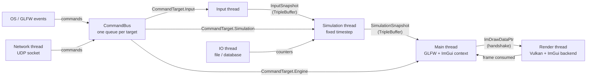
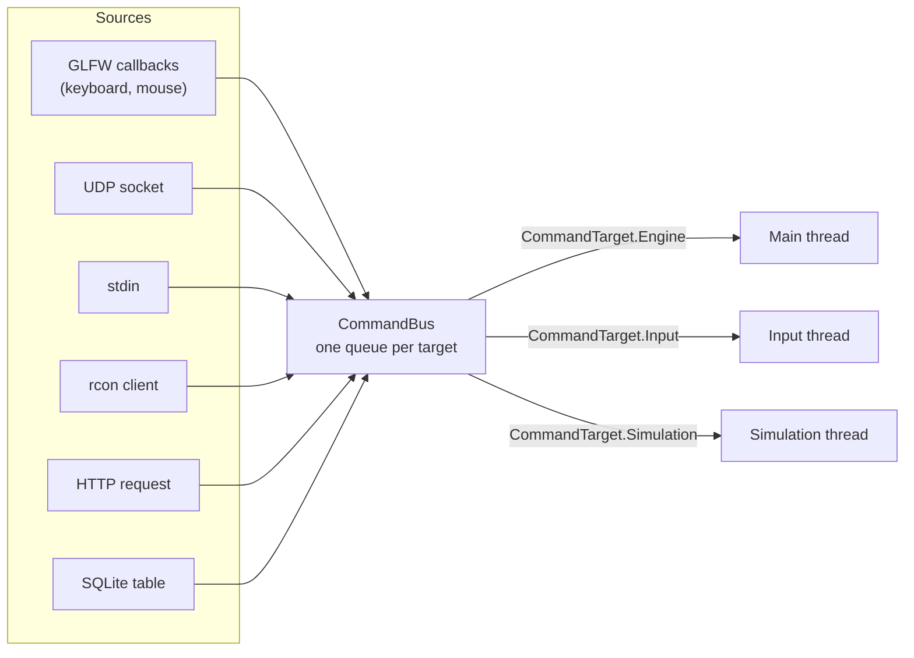
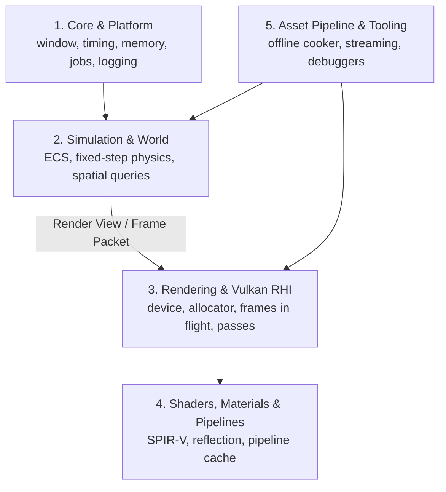

# Brutal Test Engine

A minimal .NET 10 game engine built on the [BRUTAL](https://github.com/ahwootech/BRUTAL) framework.
It opens a GLFW window, renders a triangle with Vulkan, and draws a Dear ImGui debug panel over it.
The simulation runs on a fixed timestep on its own thread, with input, IO and networking each on a
thread of their own.

The solution has three projects: the engine library, a deliberately blank game that hosts it, and a
unit-test project. The engine owns no entry point — see [Layout](#layout).

BRUTAL is a framework, not an engine: it supplies the low-level pieces (windowing, Vulkan and ImGui
bindings) and leaves the architecture to you. This repository is one small architecture on top of it.

## Documentation

> **[github.com/ahwootech/BRUTAL](https://github.com/ahwootech/BRUTAL) is the source of truth for
> everything about BRUTAL** — its API surface, samples, licensing and release notes. Where this
> README and the BRUTAL repository disagree, BRUTAL wins.

Nothing here replaces that repository, and no copy of its documentation is vendored into this
project. Use these sources alongside it:

| Source | What it covers |
| --- | --- |
| [BRUTAL repository](https://github.com/ahwootech/BRUTAL) | Canonical docs: API reference, samples and guidance for every `Brutal.*` library. |
| [ahwoo.com/brutal](https://ahwoo.com/brutal) | Project home page and licensing overview. |
| [BRUTAL licence](https://github.com/ahwootech/BRUTAL/blob/main/LICENSE.txt) | Terms and the attribution obligations for shipped products. |
| [NuGet package pages](https://www.nuget.org/packages?q=Ahwoo.BRUTAL) | Per-package versioning for the `Ahwoo.BRUTAL.*` packages this project references. |
| This README | Only what is specific to this repository: engine layout, how a frame is built here, the threading model, and the architecture we are growing towards. |
| [Vulkan specification](https://registry.khronos.org/vulkan/specs/latest/html/vkspec.html) and [Vulkan Samples](https://docs.vulkan.org/samples/latest/README.html) | The API semantics underneath BRUTAL's Vulkan bindings. |

Because BRUTAL is deliberately a framework rather than an engine, it documents the pieces it hands
you — not a scene graph, render graph or asset pipeline. Those are ours to design, and the
[Architecture](#architecture) section below is the shape this engine is aiming for.

## Use BRUTAL's types, don't reinvent them

This repository is a thin architecture on top of BRUTAL. It is **not** a place to reimplement what
the framework already provides.

**If BRUTAL exposes a type, class or API for something, use it.** Do not hand-roll a private
equivalent in this repo — no parallel math structs, no second Vulkan wrapper, no home-grown GLFW
binding. Concretely:

- **Math types:** use `Brutal.Numerics` (`int2`, `float2`, `float4`, matrices, `ByteSize32`,
  `ByteSize64`, …) — not `System.Numerics` and not custom vector structs.
- **Vulkan:** go through `Brutal.VulkanApi`, `Brutal.VulkanApi.Abstractions` and
  `Brutal.VulkanApi.Vma` — `Instance`, `DeviceEx`, `Queue`, `CommandBuffer`, `VmaAllocator` and
  friends. Don't add our own P/Invoke bindings or call `vk*` entry points directly.
- **Windowing and input:** use `Brutal.GlfwApi`, not another GLFW wrapper.
- **Strings and logging:** use `Brutal.Strings` (`Utf8`, `ImString`) and the logging pipeline, not
  bespoke string helpers or `Console.WriteLine` for engine logs.
- **Shader compilation:** use `Brutal.ShaderCApi`, not an external `glslc` invocation.
- **ImGui:** use `Brutal.ImGuiApi` and `Brutal.ImGuiApi.Backends`, not raw bindings.

What *is* ours is the architecture: the layering, the loop, ownership and lifetime policy, and the
gameplay/world code. Even there, reach for framework primitives first and write new code only where
BRUTAL deliberately leaves a gap — which is the entire point of a framework.

BRUTAL ships far more than the subset this project currently references, so before writing anything
non-trivial, check the [BRUTAL repository](https://github.com/ahwootech/BRUTAL) for an existing
library. For example: `Brutal.Jolt` and `Brutal.Box2D` for physics,
`Brutal.Gltf`/`Brutal.Ktx`/`Brutal.MeshOptimizer` for assets and meshes, `Brutal.Concurrency` for
jobs, `Brutal.Memory` for allocators, `Brutal.Fmod` for audio, `Brutal.Monitor.*` for diagnostics.
Adding a package reference to an existing `Ahwoo.BRUTAL.*` library beats writing our own.

Currently referenced: `Ahwoo.BRUTAL.Core`, `.Glfw`, `.ImGui`, `.ImGui.Backends`, `.Memory`,
`.Numerics`, `.ShaderC`, `.Strings`, `.Vulkan`, `.Vulkan.Abstractions` and `.Vulkan.Vma` — see
[BrutalTestEngine.csproj](src/BrutalTestEngine/BrutalTestEngine.csproj). They are referenced by the
engine library only, so a game inherits them by referencing the engine once.

## What it does

- Creates a resizable GLFW window with no OpenGL context (`GLFW_NO_API`), ready for Vulkan.
- Sets up a Vulkan 1.3 instance, surface, device, swapchain, render pass and per-frame
  synchronisation.
- Rebuilds the swapchain whenever the framebuffer size changes, and can switch between a windowed
  and a borderless-fullscreen window.
- Compiles two inline GLSL shaders at runtime with ShaderC and draws a coloured triangle from a
  VMA-allocated vertex buffer.
- Runs Dear ImGui with the GLFW and Vulkan backends, recording its draw lists into the same render
  pass so the debug panel composites over the scene.
- Shows frame time, FPS, framebuffer size and the Vulkan device name, with a toggle for the ImGui
  demo window.
- Switches between windowed and borderless fullscreen from the debug panel's radio buttons or with
  <kbd>F11</kbd>.
- Runs the simulation on a fixed timestep on its own thread, decoupled from the frame rate, with
  input, IO and networking each on a thread of their own.
- Routes every intent — keyboard, mouse, network, console, remote console, web and database — through
  one threaded command queue, with an in-engine console panel that shows the live command stream.

Pressing <kbd>Escape</kbd> closes the window.

## Prerequisites

- [.NET 10 SDK](https://dotnet.microsoft.com/download) — the BRUTAL packages target `net10.0` only.
- A Vulkan 1.3 capable GPU with current drivers. Vulkan arrives with your GPU driver on Windows.
- Optional: the [Vulkan SDK](https://vulkan.lunarg.com/) for validation layers. Pass `--validate` to
  enable them when they are installed.

## Running

```sh
dotnet run --project src/BrutalTestEngine.Game
```

Options:

| Argument | Description |
| --- | --- |
| `--frames=N` | Render `N` frames then exit instead of running until the window closes. |
| `--tick-rate=HZ` | Simulation ticks per second (default `60`). Independent of the frame rate. |
| `--validate` | Enable the Vulkan validation layer when it is installed. |
| `--fullscreen` | Start in borderless fullscreen instead of a windowed window. |
| `--web=PORT` | Listen for commands as HTTP requests on `127.0.0.1:PORT`. |
| `--database=PATH` | Poll a SQLite database at `PATH` for commands. |
| `--selftest` | Drive every command source, verify the results, then exit. |
| `--help` | Print usage. |

`--frames` is there so the whole startup, render and shutdown path can be exercised without a human
closing the window:

```sh
dotnet run --project src/BrutalTestEngine.Game -- --frames=120 --validate
```

`--tick-rate` is there to prove the simulation is not tied to the frame rate. The same frame count
produces a different tick count as the rate changes:

```sh
dotnet run --project src/BrutalTestEngine.Game -- --frames=180 --tick-rate=30   # ~51 ticks
dotnet run --project src/BrutalTestEngine.Game -- --frames=180 --tick-rate=240  # ~300 ticks
```

## Layout

The engine is a library. It owns no entry point and no process; a *game* project references it and
supplies `Main`. That split is deliberate: a seamless-world server and a client are two different hosts
over one authoritative simulation, so the engine cannot be allowed to assume it is an application.

```
BrutalTestEngine.slnx
src/BrutalTestEngine           the engine library (net10.0, OutputType=Library)
├── Engine
│   ├── EngineOptions.cs       title, size, frame limit, tick rate, validation toggle, start mode
│   ├── Engine.cs              lifecycle, thread ownership and the main-thread frame loop
│   ├── Window.cs              GLFW lifetime, the window itself, windowed/fullscreen modes
│   ├── WindowMode.cs          windowed or borderless fullscreen
│   ├── VulkanRenderer.cs      instance, device, swapchain, render pass, triangle pipeline
│   ├── SwapchainState.cs      everything rebuilt when the swapchain is recreated
│   ├── RenderThread.cs        the render thread and the main↔render frame handshake
│   ├── ImGuiVulkanRenderer.cs the ImGui Vulkan backend, owned by the render thread
│   ├── DebugUi.cs             ImGui context, GLFW backend and the debug panel (main thread)
│   ├── CommandSelfTest.cs     drives every command source end to end and reports the result
│   ├── ThreadMetrics.cs       rolling per-thread latency statistics: last, mean, p99 and max
│   ├── ThreadTimerRegistry.cs one named metric per piece of work, shared by every thread
│   └── Vertex.cs              position + colour vertex
├── Threading
│   ├── MpscQueue.cs           multi-producer/single-consumer queue for inbound work
│   └── TripleBuffer.cs        lock-free single-writer/single-reader state handoff
├── Commands
│   ├── Command.cs             the command abstraction, its sources and targets, and every command type
│   ├── CommandBus.cs          the concurrent per-target queues, sequencing, timing and logging
│   ├── CommandLog.cs          bounded ring buffer of recently accepted commands
│   ├── CommandParser.cs       the shared text grammar used by every text transport
│   ├── ICommandHandler.cs     the visitor that forces every consumer to handle every command type
│   └── KeyBindings.cs         maps a key to the intent it stands for, separately from its key state
├── Simulation
│   ├── SimulationThread.cs    fixed-timestep tick loop
│   └── SimulationSnapshot.cs  immutable view of the simulation for other threads
├── Input
│   ├── InputThread.cs         folds commands into a per-frame input snapshot
│   ├── InputCommands.cs       GLFW callback vocabulary → commands
│   ├── InputSnapshot.cs       key/button/cursor state for a frame
│   └── InputKeys.cs           key codes the engine understands, without a GLFW dependency
├── Host
│   ├── ConsoleCommandSource.cs reads commands from stdin on its own thread
│   ├── RconServer.cs          loopback TCP line server
│   └── WebCommandSource.cs    loopback HTTP listener
├── Database/DatabaseCommandSource.cs  watches a SQLite table through the IO thread
├── Io/IoThread.cs             background file/database work queue
├── Networking/NetworkThread.cs loopback UDP socket on its own thread
└── Shaders/TriangleShaders.cs inline GLSL compiled at runtime

src/BrutalTestEngine.Game      the game's executable: references the engine and owns Main
└── Program.cs                 argument parsing, top-level error handling, exit codes

tests/BrutalTestEngine.Tests   NUnit tests over the engine's concurrency and command layer
├── Commands/…                 parser round-trips, bus routing and ordering, log bounds, bindings
└── Threading/…                queue and triple-buffer behaviour under contention
```

Creation order is window → Vulkan → ImGui → worker threads, and disposal runs in reverse because the
ImGui backends reference the render pass and the window.

### Why the engine is a library

The split is not bookkeeping. A seamless world is served by a headless node *and* played through a
client, and both must run the same authoritative simulation from the same command stream. If the
engine owned `Main` and parsed its own arguments, a dedicated server build would mean a second
executable with a second copy of that logic.

So the dependency runs one way: `BrutalTestEngine.Game` references `BrutalTestEngine`, never the
reverse, and [Engine.Create](src/BrutalTestEngine/Engine/Engine.cs) takes a fully-formed
[EngineOptions](src/BrutalTestEngine/Engine/EngineOptions.cs) rather than reading `args`. Any host —
this game, a test, a future headless server — supplies its own entry point and its own configuration.
The game is currently blank on purpose: it parses arguments, runs one engine and exits. Gameplay,
scenes and content go there, not in the engine.

`dotnet run` needs the project that has `Main`, which is why every command below names
`src/BrutalTestEngine.Game`.

## Notes

- The window is resizable and the swapchain is rebuilt whenever the framebuffer size changes,
  including when switching between windowed and borderless fullscreen. Exclusive fullscreen — which
  means changing the monitor's video mode — is deliberately not offered.
- Borderless fullscreen undecorates the window and covers the monitor it currently sits on, hiding
  the taskbar; leaving it restores the previous window geometry. The viewport and scissor are dynamic
  state, so resizing never invalidates the triangle pipeline.
- While the window is minimised the framebuffer has no area. Vulkan rejects a zero-extent swapchain,
  framebuffer and viewport, so the loop idles and keeps the existing swapchain, rebuilding it once a
  real size returns.
- Frames in flight are capped at two. Each frame owns a command buffer, acquire semaphore and fence,
  while the render-finished semaphores are per swapchain image; the fences are keyed on the frame
  slot, not the acquired image.
- The render pass clears to a dark blue-grey, transitions the image to
  `VK_IMAGE_LAYOUT_PRESENT_SRC_KHR`, and is shared by the triangle and ImGui.
- `ImString.SharedStorage.Reset()` is called once per frame, as BRUTAL's samples require, so
  interpolated ImGui strings don't leak.
- The ImGui Vulkan backend captures the swapchain image count when it is constructed and asserts on
  it every frame, so it is rebuilt only when that count changes. A plain resize — including the
  <kbd>F11</kbd> toggle — keeps the same count and reuses the backend, which also preserves the
  textures ImGui has already uploaded. When a rebuild is unavoidable the live textures are marked
  destroyed so ImGui re-requests them, and one frame is skipped because the draw data in flight
  still refers to the old backend's textures.
- <kbd>F11</kbd> is not special-cased anywhere in the input path. The key press goes onto the bus
  like any other, the simulation gets its key state as usual, and a `KeyBindings` entry separately
  contributes a `ToggleWindowModeCommand`. Bindings live in a table rather than in the GLFW callback
  because bindings are data: a remap feature or an rcon `bind` verb should change the table, not the
  input path.
- Windows reports a datagram larger than the receive buffer as `SocketError.MessageSize` from
  `ReceiveFrom` instead of returning a short read. The network thread catches that case specifically
  and counts it as a rejected frame, because leaving it to the generic handler would tear the receive
  loop down.
- Strict UTF-8 decoding is used for network payloads (`throwOnInvalidBytes: true`). The default
  decoder silently substitutes replacement characters, which would make a malformed frame look like a
  valid one carrying different text.

## Threading

The engine is multithreaded as a first principle: the simulation tick is not the render loop, and
input, IO and networking each have a thread of their own. Nothing shares mutable state across a
thread boundary — every handoff is either an immutable snapshot or a queue.



| Thread | Priority | Owns | Talks to the rest of the engine through |
| --- | --- | --- | --- |
| Main | Normal | GLFW event dispatch, window mode, the ImGui context and GLFW backend, the frame build | Posts commands to the bus, drains `CommandTarget.Engine`, reads `TripleBuffer` snapshots, the frame handshake with the render thread |
| Simulation | Above normal | The world state and the fixed-timestep accumulator | Drains `CommandTarget.Simulation` from the bus, `TripleBuffer<SimulationSnapshot>` out, `TripleBuffer<InputSnapshot>` in (through the input thread's serialised reader) |
| Render | Above normal | The Vulkan device, swapchain, pipelines and the ImGui Vulkan backend | The frame handshake with the main thread |
| Input | Above normal | Folding commands into per-frame state | Drains `CommandTarget.Input` from the bus, `TripleBuffer<InputSnapshot>` out |
| IO | Below normal | File, database and other blocking work | `MpscQueue<IoJob>` in, a completion counter out |
| Network | Below normal | A UDP socket and its receive loop | Posts commands to the bus, `MpscQueue` for outbound datagrams, a receive counter out |
| Console | Below normal | Reading lines from stdin | Posts commands to the bus |
| rcon accept | Below normal | Accepting remote console connections | Posts commands to the bus; one further thread per client |

A command is the only thing that crosses a thread boundary in the inbound direction, and the only
thing that decides where a command goes is the target on the command itself. Nothing is shared
mutable state: the simulation and the UI read immutable snapshots, and worker progress is reported
through counters.

### Why the split falls where it does

- **GLFW is main-thread-only.** BRUTAL's XML docs mark the windowing entry points
  `<threadSafety>This function must only be called from the main thread.</threadSafety>`, and
  `GlfwBackend` installs GLFW callbacks that call ImGui directly. So event dispatch, the ImGui
  context and the GLFW platform backend all stay on the main thread.
- **ImGui is single-context.** `VulkanBackend.RenderDrawData` reads `ImGui.GetPlatformIO()`, so the
  platform half and the renderer half must never run concurrently. The engine enforces that with a
  strict ping-pong: the main thread builds a frame and publishes its draw data, then blocks; the
  render thread records that draw data, submits and presents, then signals. The main thread only
  builds the next frame after the render thread has finished with the previous one, so the two are
  never inside ImGui at the same time — while submit and present still overlap with the next build.
- **The simulation must not be tied to the frame rate.** It runs a fixed timestep, accumulating real
  time and consuming it in whole steps. If the renderer stalls, the simulation catches up in bounded
  steps rather than spiralling: the accumulator is clamped to eight steps per iteration and the
  excess is counted as dropped ticks, which the debug panel reports.
- **Blocking work must not block the frame.** IO and networking are the two places where a syscall
  can stall for an unbounded time, so they get their own threads and report progress through
  counters rather than by making anyone wait.
- **The command bus is the way in, so no thread reaches into another.** Because every source posts to
  the bus and each target has exactly one consumer thread, a GLFW callback, a socket read and an
  ImGui button press all end up as the same kind of object applied by the same code path. The bus is
  what makes it safe to have this many threads without a locking policy for shared state: there is no
  shared state, only queues and snapshots.

### The handoff primitives

- `MpscQueue<T>` — many producers, one consumer, over `ConcurrentQueue<T>` plus a `SemaphoreSlim` so
  the consumer can block with a timeout instead of spinning. Used for inbound work (IO jobs, outbound
  datagrams) and as the per-target storage inside `CommandBus`.
- `TripleBuffer<T>` — single writer, single reader, lock-free. The writer fills a slot it owns and
  hands it to the reader through one atomic compare-exchange, so the reader always takes the newest
  published instance and never blocks either side. Used for state that is overwritten rather than
  queued (input snapshots, simulation snapshots), so a slow reader skips stale state instead of
  falling behind. The single-reader rule is load-bearing and the type documents it; the input
  snapshots have two readers (the simulation thread and the main thread), so
  [InputThread](src/BrutalTestEngine/Input/InputThread.cs) serialises access to the buffer rather than
  letting two threads claim the same slot.
- **The command bus** — one `MpscQueue` per target, plus a monotonically increasing sequence number,
  a timestamp and a bounded log taken on the producing thread. Posting never blocks, because it runs
  inside GLFW callbacks and socket reads.
- **The frame handshake** — a pair of `SemaphoreSlim`s plus a small lock-guarded set of pending
  frame fields. It is deliberately not a queue: ImGui has exactly one frame in flight, and the
  render thread always releases the "consumed" semaphore in a `finally`, so a failure on the render
  thread can never deadlock the main thread.
- **The timing registry** — one `ThreadMetrics` per named piece of work, resolved once per thread and
  recorded in place. It is what turns "the simulation is fine" into a measured claim; see
  [Timing every thread](#timing-every-thread).

### Reading the debug panel

The panel reports the two rates side by side, which is the quickest way to see the decoupling:

- **FPS** is the render thread's rate.
- **Simulation** is the simulation thread's measured tick rate against its target, with the tick
  count, elapsed time and dropped ticks.
- **Input events**, **IO jobs** and **Network messages** are the per-thread counters, so you can see
  each worker is alive and making progress independently.
- The **Thread timings** table is the latency view — see [Timing every thread](#timing-every-thread).
- The **Command console** panel reports accepted and pending commands, the per-target applied counts,
  the drain cost and the per-source counters.

On a 144 Hz display the panel typically shows FPS around 144 while the simulation holds 60.0 ticks/s
with zero dropped ticks.

### Timing every thread

Counters say a thread is alive; they do not say what it costs. The **Thread timings** table reports,
for every named piece of work, four figures in milliseconds.

| Column | Question it answers |
| --- | --- |
| **Last** | What did the most recent sample cost? |
| **Mean** | What does it normally cost, over a rolling window of 256 samples? |
| **p99** | What does it cost on the bad frames? Tinted when it passes 5 ms. |
| **Max** | What is the worst it has ever been, over the whole session? |

Four figures rather than one average, because they detect different problems. A thread with a mean of
0.1 ms and a p99 of 30 ms stutters roughly once a second and would look perfect in a mean-only table;
conversely a high mean with a tight p99 is a thread doing steady, expensive work rather than one
hitching. `Max` is deliberately session-wide rather than windowed, so a single startup spike cannot
scroll away.

The metrics and their keys live in [ThreadTimerRegistry.cs](src/BrutalTestEngine/Engine/ThreadTimerRegistry.cs);
the statistics are in [ThreadMetrics.cs](src/BrutalTestEngine/Engine/ThreadMetrics.cs). What is measured:

| Key | Where | What it covers |
| --- | --- | --- |
| `main.frame` | Main | The whole frame: event polling, engine drain, ImGui build, waiting on the renderer. |
| `main.drain` | Main | Applying `CommandTarget.Engine` commands, i.e. window mode and tick rate. |
| `main.wait` | Main | Blocked on the render thread. Usually the largest item, and the one worth separating. |
| `render.frame` | Render | `RenderFrame`: recording, submitting and presenting. |
| `sim.tick` | Simulation | One `Tick()`. This is the number that must stay well under the timestep. |
| `sim.cycle` | Simulation | One pass of the loop excluding the deliberate sleep, so idle time is not disguised as work. |
| `sim.drain` | Simulation | Applying `CommandTarget.Simulation` commands. |
| `input.drain` | Input | Applying `CommandTarget.Input` commands. |
| `input.publish` | Input | Writing the input snapshot, including the 4 ms rate limit. |
| `io.job` | IO | One IO job's work, excluding the caller's completion callback. |
| `net.poll` | Network | One poll cycle including the blocking `Poll`, so it reads as the thread's occupancy. |
| `net.decode` | Network | Parsing and dispatching one received datagram. |
| `db.poll` | Database source | One database poll, measured across the hand-off to the IO thread and back. |

Two details are deliberate. Measurements are taken in a `finally` wherever the measured code can
throw, because an exception is exactly when the timings matter most. And each thread resolves its
metric once in its constructor, so recording in a tick loop is a few arithmetic operations on a plain
reference rather than a dictionary lookup.

The same figures are printed after a headless run, which is the only timing information available
when there is no panel:

```sh
dotnet run --project src/BrutalTestEngine.Game -- --frames=200
```

```
Thread timings:
  main.frame       last   6.890 ms   mean   6.941 ms   p99   7.571 ms   max   33.316 ms   200 sample(s)
  main.wait        last   6.690 ms   mean   6.502 ms   p99   7.296 ms   max   14.968 ms   200 sample(s)
  render.frame     last   6.671 ms   mean   6.483 ms   p99   7.283 ms   max   14.875 ms   200 sample(s)
  sim.tick         last   0.002 ms   mean   0.008 ms   p99   0.089 ms   max    0.490 ms   84 sample(s)
```

Even on a trivial scene that output is informative: `main.wait` is almost the whole of `main.frame`,
so the main thread is not the bottleneck — it is idle waiting for the render thread, which is turn
waiting on the display. A metric that never fired prints `no samples` rather than `0.000`, because a
thread that was never asked to do anything is a different fact from one that did nothing quickly.

## Commands

Once the engine loop is running, **nothing mutates state directly**. Every intent — a keystroke, a
UDP datagram, a line typed into a console, an HTTP request, a new database row — becomes a
`Command`, is posted to one concurrent queue, and is applied by the thread that owns the state it
touches. There is exactly one way into the engine, and it is the same way regardless of where the
intent came from.

This matters more than it sounds. A command stream is a *record*: if every state change arrived as a
command, then a recorded stream replays to the same state, a network protocol is just a command
transport, and a test is just a scripted stream. That is the foundation the sharded world in the
[Architecture](#architecture) section is meant to be built on: simulating a region twice on two
machines produces the same world only if both machines applied the same commands in the same order,
and a seam between two servers is only invisible if a player's intent can be handed from one to the
other as a message rather than as a function call.

### Commands, targets and sources



A command declares two things beyond its payload: the `CommandSource` it came from (`System`,
`Input`, `Network`, `Remote`, `Web`, `Database`) and the `CommandTarget` whose invariants it touches.
The source is provenance for the log and the UI; the target is routing, and it is the reason there
is only ever one decision point per piece of state:

| Target | Owner | Why |
| --- | --- | --- |
| `Engine` | Main thread | Window mode, the tick rate, shutdown — anything that needs the GLFW/ImGui context. |
| `Input` | Input thread | Key, button, cursor and scroll state; the input thread folds these into a per-frame snapshot. |
| `Simulation` | Simulation thread | Ticks, pause, reset — anything that changes the world. |

Routing a key press to `Input` rather than `Simulation` is deliberate. The simulation wants
*snapshot* state ("is Left held?"), not a stream of edges, so it reads the snapshot the input thread
published. A network command carrying "key down Left" therefore converges onto exactly the same path
as the physical key, which is what makes a remote client indistinguishable from a local one.

### Handlers are exhaustive by construction

`ICommandHandler` is a visitor with one overload per command type, and `CommandDispatcher` switches
over the concrete type. Adding a command type makes the compiler fail every handler that has not
decided what to do about it, so a new intent can never be silently dropped. Handlers that do not own
the command call a local `Ignore()`; the command has still been seen, counted and logged.

Commands are drained by their owner at a well-defined moment — the main thread drains `Engine` once
per frame *before* it draws, and the simulation drains `Simulation` at the tick boundary. Draining at
the tick boundary is what makes the stream deterministic: every simulation command takes effect on an
exact tick, in sequence, no matter when it arrived or over which transport.

Both drains are bounded (`MaxCommandsPerFrame`, `MaxCommandsPerDrain`). A source that floods the bus
delays the *next* frame rather than stalling the current one, and the leftovers keep their order.

### One grammar for every text transport

`CommandParser` is the single wire format. Console, rcon, web, network and the `inject` verb all
parse the same lines, and `TryFormat` writes them back, so any transport is round-trippable:

| Verb | Effect |
| --- | --- |
| `help` | Print the verb list. |
| `quit` | Close the window. |
| `window-mode [windowed\|fullscreen\|toggle]` | Switch presentation mode. |
| `tick-rate <hz>` | Change the simulation rate. |
| `key [down\|up\|repeat] <key>` | Synthetic key event. |
| `mouse <down\|up> <button>`, `cursor <x> <y>`, `scroll <x> <y>` | Synthetic pointer events. |
| `text <string>`, `focus <gained\|lost>` | Synthetic text and focus events. |
| `inject <command...>` | Hand a line to the engine to route (see below). |
| `step <ticks>`, `pause`, `resume`, `reset-simulation` | Drive the simulation without the wall clock. |

`key`, `step` and the rest are not test-only affordances. They are how a remote client, a script or a
future replay tool drives the engine without owning a keyboard, and they share the parser precisely
so they cannot drift from what a human types.

### The `inject` indirection, and why it exists

A line arriving over rcon or HTTP is just text. The socket cannot know whether `step 20` belongs to
the simulation or `tick-rate 200` to the engine, and it must not be allowed to choose — a remote
source picking a target would let it pick which thread it runs on. So unrecognised-but-valid intent
becomes an `InjectInputCommand` targeted at `Engine`, and the engine re-parses that line with the
same parser and posts the result to the target that owns it.

That extra hop is the whole design in miniature: transports carry text, the engine decides what it
means, and the owning thread applies it. Recursion is blocked for `inject`, `help` and unparsable
input.

### Sources

All listeners bind to `127.0.0.1` on purpose. An unauthenticated command endpoint on a public
interface would be a remote code execution hole, and authorisation is a question to answer properly
before anything is exposed.

| Source | Transport | Notes |
| --- | --- | --- |
| Host console | stdin | A background thread reads lines; end of input ends it cleanly. |
| rcon | TCP line protocol | Bounded clients, bounded line length, bounded outbound queue. |
| Network | UDP | Strict UTF-8, bounded datagram, malformed frames counted rather than fatal. |
| Web | HTTP on `--web=PORT` | `?cmd=` or the request body; the index page lists examples. |
| Database | SQLite on `--database=PATH` | Polls for rows with an `id` greater than the last seen one. |

```sh
# Web: the easiest way to poke a running engine
dotnet run --project src/BrutalTestEngine.Game -- --web=8321
curl "http://127.0.0.1:8321/?cmd=tick-rate%20200"

# rcon: the port is printed on startup, so read it from there
printf 'pause\nstep 30\nresume\n' | ncat 127.0.0.1 <port>

# Console: type commands into the terminal the engine is running in
echo 'inject key down Left' | dotnet run --project src/BrutalTestEngine.Game -- --frames=300
```

Nothing in a source's code touches engine state. `RconServer` never posts a command for a target it
chose itself — every line it receives becomes an `InjectInputCommand`, and the engine routes it.

### Bounded by default

Every queue and buffer has a ceiling, so no source can exhaust memory or wedge the engine: the
command log is a ring buffer, drains and polls have per-call limits, the rcon server caps clients,
line length and its outbound queue, the web source caps body size, and the network source caps
datagram size and payload characters. Exceeding a limit is counted and surfaced, never silent.

The engine also measures how long its own drain takes and reports a drain that is slow for no
structural reason. A window-mode change rebuilds the swapchain and legitimately costs milliseconds;
anything else that slow means a handler is eating the frame budget.

### The console panel

The `Command console` panel is a view over the bus, not a second input path. It shows the accepted
and pending totals, the per-target applied counts, the drain cost, the per-source counters, and the
recent command log with each row's sequence, source and resolved target. Typing a line posts it
exactly as stdin would.

Because the panel renders a snapshot gathered on the main thread, it cannot race a source thread, and
no source thread ever touches ImGui.

### Verifying it

```sh
dotnet run --project src/BrutalTestEngine.Game -- --selftest --validate
```

`--selftest` drives every source from the outside — a real UDP datagram and one oversized datagram, a
real TCP client, real HTTP requests, real database rows, and an `inject` line — then verifies each
one landed on the right target with the right count, and exits non-zero if not. It is the regression
test for the whole command path.

## Engineering standards

This project is meant to be read as a worked example, not just a triangle. The rules below are what
the existing code actually does — with a few honest gaps listed at the end, which are the standards we
have adopted but not yet enforced.

The guiding constraint is that an engine is a real-time system with hard deadlines. Frame and tick
budgets are not negotiable, threads are a design tool rather than an optimisation, and an abstraction
that costs an allocation per frame is a design bug. Correctness and predictability outrank
cleverness; clarity outranks density.

### SOLID, concretely

The acronym is only useful if it maps to a decision you can point at.

- **Single responsibility.** One type per concern, named after the concern:
  [CommandBus.cs](src/BrutalTestEngine/Commands/CommandBus.cs) admits and routes commands,
  [CommandLog.cs](src/BrutalTestEngine/Commands/CommandLog.cs) retains history,
  [CommandParser.cs](src/BrutalTestEngine/Commands/CommandParser.cs) owns the grammar, and
  [KeyBindings.cs](src/BrutalTestEngine/Commands/KeyBindings.cs) owns the key-to-intent table. The bus
  does not parse, the parser does not route, and neither logs.
- **Open/closed.** New command *types* extend the system without modifying the bus, the parser, the
  log or any transport. The one place that must change is the dispatcher, and the compiler forces that
  change (see *Handlers are exhaustive by construction*).
- **Liskov substitution.** `ICommandHandler` implementations are interchangeable consumers —
  [Engine.cs](src/BrutalTestEngine/Engine/Engine.cs),
  [SimulationThread.cs](src/BrutalTestEngine/Simulation/SimulationThread.cs) and
  [InputThread.cs](src/BrutalTestEngine/Input/InputThread.cs) each handle the full interface and no
  caller needs to know which one it holds.
- **Interface segregation.** `IImGuiRenderer` in
  [DebugUi.cs](src/BrutalTestEngine/Engine/DebugUi.cs) is a one-method interface because that is all a
  renderer needs from the UI: `void Render(CommandBuffer)`. The render thread is not handed the ImGui
  context or the window, so it cannot accidentally use them.
- **Dependency inversion.** `SimulationThread` takes `Func<InputSnapshot>`, `Func<long>` and friends
  rather than concrete threads, so the simulation depends on *readers* and not on the renderer, the IO
  thread or the network thread. `Engine.Create` is the composition root: it constructs the bus, the
  threads and every source in one place, so no type news up its own collaborators.
  [Program.cs](src/BrutalTestEngine.Game/Program.cs) stays a thin shell that parses and validates
    arguments and then hands them over. It lives in the game project, not the engine, because the engine
    has no business owning a process or an argument grammar.

### Composition over inheritance

`Command` is the only type in the project intended to be inherited from — and even that is a `record`
hierarchy, used solely so the visitor can discriminate on concrete type. Everything else is `sealed`
(40 declarations), because inheritance is an extension point you should have to opt into
deliberately, and a sealed type tells a reader that the class has no subclass contract to honour.
Shared behaviour otherwise arrives through composition (`CommandBus` *has* `MpscQueue`s) or through
delegates.

Records are used for value-like messages and options (`Command` and its 16 subtypes, plus
`EngineOptions`, `IoJob`, `WebEvent`, `DatabaseRow` and the readonly record structs) — 19 record
declarations. `required` plus `init` — 49 and 59 uses — makes invalid construction a compile error
rather than a runtime one, and makes a record immutable once built.

### Patterns in use, and why

| Pattern | Where | Why it earned its place |
| --- | --- | --- |
| Command | [Command.cs](src/BrutalTestEngine/Commands/Command.cs) | Turns a keystroke, a datagram and a database row into one replayable value with a source, a sequence and a timestamp. |
| Mediator | [CommandBus.cs](src/BrutalTestEngine/Commands/CommandBus.cs) | Sources and consumers never reference each other; the bus is the single place ordering, timing and logging live. |
| Visitor | [ICommandHandler.cs](src/BrutalTestEngine/Commands/ICommandHandler.cs) | Makes "you forgot to handle the new command" a compile error instead of a silently dropped intent. |
| Observer | GLFW callbacks in [Engine.cs](src/BrutalTestEngine/Engine/Engine.cs), `SwapchainRecreated` in [VulkanRenderer.cs](src/BrutalTestEngine/Engine/VulkanRenderer.cs) | The OS owns event dispatch and the swapchain owns its own rebuild; subscribers do not poll. |
| Strategy / table-driven dispatch | [KeyBindings.cs](src/BrutalTestEngine/Commands/KeyBindings.cs), `CommandParser.Parse` | Bindings and verbs are *data*, so remapping or adding a verb changes a table rather than a control-flow graph. |
| Adapter | [VulkanRenderer.cs](src/BrutalTestEngine/Engine/VulkanRenderer.cs), [ImGuiVulkanRenderer.cs](src/BrutalTestEngine/Engine/ImGuiVulkanRenderer.cs) | BRUTAL's and ImGui's vocabularies are adapted once, so the rest of the engine never sees `Vk*` or `Im*` naming. |
| Facade | [Engine.cs](src/BrutalTestEngine/Engine/Engine.cs) | Eight threads and eleven collaborators are hidden behind `Create`/`Run`/`Dispose`. |
| Snapshot / triple buffer | [TripleBuffer.cs](src/BrutalTestEngine/Threading/TripleBuffer.cs) | Decouples a producer from a consumer with no locking and no tearing. |
| Object pool (bounded) | Reused `_logBuffer`, `_consoleInput`, per-frame arrays | Steady-state zero allocation on the hot path. |
| Producer/consumer | [MpscQueue.cs](src/BrutalTestEngine/Threading/MpscQueue.cs) | Inbound work from many threads, executed serially by exactly one owner. |

Two patterns are deliberately **absent**, and should stay that way until there is a reason:

- **No service locator, no global singleton, no static mutable state.** State lives in a type that
  owns it and is passed in. `Console.WriteLine` at startup is the only global side channel, and it is
  output, not state.
- **No reflection-based dispatch.** The visitor is explicit, so a hot path never pays for a type scan
  or a dictionary lookup it did not ask for.

### Concurrency rules

These are not suggestions; every thread in the engine follows them.

1. **Each piece of mutable state has exactly one owning thread.** That is what makes the `Ignore()`
   bodies in `ICommandHandler` implementations honest — a handler never touches another thread's
   state because it never receives another thread's commands.
2. **A command is the only thing that crosses a thread boundary inbound.** No shared flags, no
   cross-thread property setters, no `lock` around simulation state.
3. **Outbound, share immutable snapshots, never objects.** `SimulationSnapshot` and `InputSnapshot`
   expose `internal set` only: the buffer guarantees writer and reader never hold the same instance,
   so the public surface reads as immutable without allocating per publish.
4. **Never block a thread you do not own.** GLFW callbacks post and return. `IoThread` exists so
   nothing else touches a disk. `NetworkThread` exists so nothing else touches a socket.
5. **Bound every drain.** `MaxCommandsPerFrame` and `MaxCommandsPerDrain` mean a flooding source
   delays the next frame and not the current one. A queue without a ceiling is a memory leak with a
   longer fuse.
6. **Use the weakest correct primitive.** `Interlocked` (69 uses) and `volatile` (13) for counters and
   flags; `SemaphoreSlim` for blocking handoffs (the ImGui frame ping-pong, the MPSC wake signal) and
   `ManualResetEventSlim` in one place; `ConcurrentQueue`/`ConcurrentDictionary` rather than a locked
   collection. A `lock` appears only where a compound update genuinely needs mutual exclusion — three
   `System.Threading.Lock` fields (command sequencing, the command log, the web request history) and
   two plain `object` gates (the render frame slot, the renderer's pending resize). No `Monitor`, no
   `ReaderWriterLockSlim`, and never a `lock` on a publicly reachable object.
7. **Poll with a timeout, and treat the timeout as normal.** Receive and drain loops wait in the 4–16
   ms range so cancellation stays responsive without busy-spinning; the one longer wait (100 ms, on
   the render thread) is a wake-up interval, not a deadline.
8. **Shut down in reverse construction order, and cancel before joining.** Sources stop first so
   nothing new is posted, then consumers, then the resources both used. Background threads are
   `IsBackground = true` with an explicit `CancellationTokenSource`, and a join has a timeout.
9. **Never deadlock a UI thread on a worker.** The main thread's wait for the render thread is bounded
   (`FrameConsumeTimeoutMs`), and a minimised window idles instead of blocking on a framebuffer that
   will never arrive.

### Real-time and memory discipline

Game-engine practice, applied:

- **Fixed timestep, variable render.** The simulation advances in equal steps; rendering runs as fast
  as the display allows. The accumulator drops ticks rather than spiralling when the machine falls
  behind, and reports the drops so the UI can show them. Simulation behaviour never depends on frame
  rate.
- **No per-frame allocation on the hot path.** Buffers are allocated once (`_logBuffer`,
  `_consoleInput`, command buffers per frame in flight) and reused. The state handoff is a triple
  buffer, not a new object per tick.
- **Two frames in flight, not one and not many.** Enough to keep the GPU fed, few enough that
  per-frame resources stay small and a fence wait is never a stall in practice.
- **Push constants for small per-frame data.** The triangle's rotation, scale and aspect go through
  `PushConstants` written on the render thread — 16 bytes, no buffer, no upload, no cross-thread
  synchronisation.
- **Dynamic viewport and scissor.** A resize never invalidates the pipeline.
- **`AllowUnsafeBlocks` is on, so `unsafe`/`fixed` is scoped tightly** — only two `fixed` statements
  exist, both inside [VulkanRenderer.cs](src/BrutalTestEngine/Engine/VulkanRenderer.cs), each pinned
  only for the duration of the call that needs the pointer.
- **Measure, do not guess.** The engine times its own command drain, warns when a drain is slow for no
  structural reason, and surfaces per-thread counters in the debug panel.
- **Batch by pipeline and material before reaching for indirect draws.** Correct first, GPU-driven
  later — the architecture section says the same thing about `vkCmdDrawIndexedIndirect`.

### Robustness and security

- **Validate at the boundary, then trust.** Arguments are validated with
  `ArgumentNullException.ThrowIfNull` and friends; `Program.cs` rejects a non-positive tick rate and
  an out-of-range port before the engine is constructed.
- **Parse culture-invariantly.** Every numeric parse and format uses
  `CultureInfo.InvariantCulture`; the project also enables `InvariantGlobalization`. A command line
  must mean the same thing on every machine.
- **Strict decoding over lossy decoding.** Network payloads use UTF-8 with
  `throwOnInvalidBytes: true`, because a replacement character would turn a corrupt frame into a
  plausible-looking command.
- **Loopback only.** rcon, web and UDP all bind to `127.0.0.1`. An unauthenticated command endpoint on
  a public interface is remote code execution, so it is not offered. Authorisation is a question to
  answer before exposure, not after.
- **Fail loudly at the edge, degrade gracefully inside.** Startup throws and exits non-zero; a
  malformed datagram, a flaky database poll or a slow drain is counted and reported rather than
  crashing a loop.
- **Test seams instead of test doubles.** The `--selftest` path drives the *real* transports and
  asserts on the counters, so removing the harness cannot leave the system looking healthier than it
  is.
- **Never silently drop an intent.** Unparsable input becomes an `UnhandledCommand` that is logged and
  counted, not discarded at the transport.

### C# style

Conventions the codebase already follows, and that new code should match:

- File-scoped namespaces (all 40 files that declare one;
  [Program.cs](src/BrutalTestEngine.Game/Program.cs) is top-level statements and needs none),
  `Nullable` and `ImplicitUsings` enabled, one type per concern per file.
- `sealed` by default; `record` for value-like data; `required`/`init` for construction safety;
  primary constructors where they genuinely shorten a type (`Vertex`).
- Expression-bodied members for one-liners; no `async`/`await` — concurrency is explicit threads with
  a documented owner, not a task graph.
- Private fields `_camelCase`, `private readonly` wherever the field is assigned only in the
  constructor (124 uses).
- `IReadOnlySet`/`IReadOnly*` on exposed collections so a caller cannot mutate owned state.
- UTF-8 literals (`"label"u8`) for ImGui text, because the engine is built with invariant
  globalisation and the label is passed to native code every frame.
- XML documentation on every public type, and a `<remarks>` block wherever a reader would otherwise
  ask "why is it done this way?". The *why* is the part that matters: several remarks exist purely to
  record a decision that looks wrong until you know the constraint behind it.

### Testing and verification

Two layers, because they catch different things:

```sh
dotnet build BrutalTestEngine.slnx
dotnet test BrutalTestEngine.slnx
dotnet run --project src/BrutalTestEngine.Game -- --selftest --validate
```

`dotnet test` runs the NUnit project in [tests/BrutalTestEngine.Tests](tests/BrutalTestEngine.Tests).
It covers what a headless run cannot see cheaply: that the parser round-trips every command through
its wire format, that the bus routes each command type to the thread that owns its effect, that
sequence numbers are dense and unique under concurrent producers, that the queues preserve per-producer
order and honour their bounds, and that the snapshot handoff never tears. Two of its cases are worth
calling out because they found real bugs rather than confirming the status quo: a torn read in
`TripleBuffer` under concurrent publish, a second reader of a buffer documented as single-reader, and a
non-finite sample that silently poisoned the timing statistics. It also covers the timing arithmetic
itself — rolling-window means, session-wide maxima, percentile interpolation and rejection of
non-finite samples — because an operator uses those numbers to decide what to optimise.

`--selftest` is the end-to-end regression test for the command system: it drives every source from
outside the engine and fails the run if a command does not land on the right target with the right
count. `--frames=N` exercises the full startup/render/shutdown path, and `--validate` turns on Vulkan
validation. Use `--frames` together with `--validate` when changing anything in the renderer.

The split matters. The unit tests run in a second and need no GPU, so they can gate every commit; the
self-test boots the real Vulkan device and every thread, so it proves the wiring the tests stub out. A
change to the command layer is expected to keep both green.

When adding behaviour, the expectation is a test at one of those two layers rather than a manual check.

### Known gaps

Stated plainly, because an unowned gap is a standard nobody is held to:

- **No CI workflow.** Tests exist now, but nothing runs them automatically; wiring
  `dotnet test` into a build workflow is the next step.
- **Test coverage is deliberately narrow.** The tests pin the command and threading layers, which is
  where the concurrency bugs are. The renderer, the shaders and the Vulkan setup have no unit tests
  and are covered only by `--frames --validate`.
- **No `.editorconfig` or `Directory.Build.props`.** Style is currently convention and review, not
  enforcement. The conventions listed above should be encoded as analyzer rules.
- **`TreatWarningsAsErrors` is off.** It should be on for a project this size.
- **Validation is opt-in.** It should be on by default in Debug builds.
- **`Brutal.Memory` and `Brutal.Concurrency` are referenced but not yet used directly.** The IO queue
  and triple buffer are hand-rolled for now; per
  [Use BRUTAL's types, don't reinvent them](#use-brutals-types-dont-reinvent-them) they should be
  replaced by the framework's equivalents where one exists.

### Review checklist

Before a change is considered done:

- Does it put state behind an owner, and does every mutation of that state happen on that thread?
- Does new input or control arrive as a command, with a source and a target, rather than as a direct
  call?
- Did you use the BRUTAL type instead of writing your own?
- Is anything unbounded — a queue, a log, a read, a retry?
- Does the hot path allocate, parse or format anything it does not have to?
- Does a new failure mode fail loudly at the edge and get counted inside a loop?
- Is the *why* recorded, where a reader would otherwise assume the code is wrong?
- Is it covered by a unit test, or by a headless run (`--frames`, `--selftest`)?

## Architecture

BRUTAL gives us a window, a Vulkan instance and ImGui. Everything above that is ours, so the goal is
the one every engine needs: **strict separation of concerns** and **decoupling CPU simulation from
GPU execution**. Vulkan exposes memory, synchronisation and pipeline state explicitly, so letting
`VkBuffer`, `VkImage` or shader structs bleed into gameplay or scene data is how a codebase turns
into spaghetti — reference types appear in hot loops, lifetimes become vague, and every gameplay
change risks a synchronisation bug.

The target is five layers with dependencies pointing strictly downwards: gameplay knows nothing
about Vulkan, and the renderer knows nothing about game rules.



### 1. Core & Platform Layer (Foundation)

Owns OS integration, timing, memory and concurrency, and knows nothing about rendering or gameplay
rules.

- **Platform / Windowing:** creates the window, polls OS events, manages input state (keyboard,
  mouse, gamepad), and exposes a surface handle to the renderer.
- **Time & Loop Management:** tracks delta time, wall clock, and fixed-timestep accumulators.
- **Memory & Job System:** custom allocators/arenas for frame-scoped scratch data, plus a thread pool
  or fiber scheduler for parallel simulation, asset loading and command-buffer recording.
- **Logging, CVars & Profiling:** structured logging, runtime console variables for live tweaking,
  and CPU/GPU timing markers.

BRUTAL already supplies much of this (`Brutal.Core`, `Brutal.Concurrency`, `Brutal.Memory`,
`Brutal.Logging`, `Brutal.Glfw`), so this layer is mostly about composing those in the shapes our
loop wants rather than writing new primitives — see
[Use BRUTAL's types, don't reinvent them](#use-brutals-types-dont-reinvent-them).

### 2. Simulation & World Layer (Game Logic)

Keep this **completely API-agnostic** — no `VkBuffer`, no `VkImage`, no shader structs. It represents
*what exists and how it behaves*.

- **Entity & Component Data (ECS or data-oriented hierarchy):** plain data components — transforms,
  velocities, health, colliders, renderable/material handles — processed by systems.
- **Fixed-Timestep Physics & Gameplay:** runs on a deterministic step (for example 60 Hz, `dt = 1/60 s`)
  with interpolation for smooth rendering at variable frame rates.
- **Scene / Spatial Representation:** transform hierarchies and spatial acceleration structures
  (BVH, octree, spatial grid) for collision, AI queries and frustum/occlusion culling.
- **Render Extraction:** at the end of a simulation tick, extract a lightweight **Render View /
  Frame Packet** — camera matrices, visible draw items, light lists, animation poses, debug lines.
  The renderer then reads a consistent snapshot while the next simulation step or worker jobs
  prepare data.

### 3. Rendering & Vulkan RHI Layer (GPU Execution)

Split the graphics side into **low-level Vulkan infrastructure** and **high-level rendering passes**
so we never drown in boilerplate.

#### A. Vulkan Context & Resource Management

- **Device & Queues:** instance, surface, physical/logical device selection, and queue families
  (graphics, compute, transfer).
- **Memory Allocator:** use **VMA** (`Brutal.Vulkan.Vma`) rather than raw `vkAllocateMemory` calls per
  resource.
- **Frames in Flight:** typically 2 or 3 concurrent frames, each with its own command pools/buffers,
  per-frame uniform/staging ring buffers and synchronisation primitives (fences, semaphores,
  timeline semaphores).
- **Synchronisation & Frame Graph:** explicit pipeline barriers (`VK_KHR_synchronization2`) or a
  **render/frame graph** that declares pass inputs and outputs, manages transient attachments and
  inserts barriers automatically. Modern Vulkan (1.3/1.4) also favours **dynamic rendering** over
  complex multi-subpass render pass objects.

#### B. Frame Passes & Draw Submission

- **Pass Pipeline:** shadow maps → G-buffer or Forward+/Clustered opaque pass → sky/environment →
  transparent pass → post-processing → UI/ImGui → swapchain present.
- **Batching & Indirect Drawing:** group draw calls by pipeline, material and mesh to minimise state
  changes, and scale up to GPU-driven culling and `vkCmdDrawIndexedIndirect` once basic rendering is
  solid.

### 4. Shaders, Materials & Pipelines

Treat shaders as **compiled assets with reflection metadata**, not hardcoded strings or ad-hoc
pipeline creation scattered across draw code.

- **Authoring & Compilation:** author in GLSL, HLSL or Slang, compile to SPIR-V (offline during asset
  cooking, plus runtime/file-watcher hot-reload in debug builds), and persist a `VkPipelineCache` to
  disk to speed up startup.
- **Reflection & Layouts:** use `SPIRV-Reflect` (or the compiler's reflection API) to inspect
  descriptor bindings, push constants and vertex/interface inputs automatically, instead of
  duplicating layouts by hand in C#.
- **Pipeline State & Bindless:** keep graphics pipelines relatively coarse-grained (per pass, shading
  model and vertex format) and use dynamic state where supported. For larger engines, move towards
  **bindless descriptor indexing** — large descriptor arrays for textures and buffers indexed by
  material ID — so descriptor sets are not rebuilt per object.
- **Materials:** a material is *data* (shader/pipeline reference, parameter block offset, texture
  indices), not a brand-new pipeline per asset.

### 5. Asset Pipeline & Tooling

Raw `.gltf`, `.obj`, `.png` and `.wav` files are slow to parse at runtime and lack GPU-friendly
layouts.

- **Offline Cooker / Importer:** convert source assets into binary engine formats (pre-triangulated
  and indexed meshes, mipmapped block-compressed textures such as BC7/ASTC, compiled SPIR-V,
  animation clips) with content hashes and versioning.
- **Async Streaming & Hot-Reload:** load and upload assets off the main thread via a transfer queue
  and staging ring buffer, and watch shader/asset files during development for instant iteration.
- **Debuggers:** integrate **RenderDoc** early, alongside an in-engine debug draw system and a GPU
  timestamp profiler.

### How a typical frame flows

1. **Poll & Step:** gather window/input events, then advance the fixed-timestep simulation (physics,
   AI, gameplay) and the variable-step animation/scripts.
2. **Extract:** build the frame's render snapshot — camera, transforms, lights, visible drawables.
3. **Wait & Acquire:** wait on the current frame-in-flight fence or timeline value, acquire the next
   swapchain image, and reset/recycle the per-frame staging and command buffers.
4. **Record & Submit:** record compute and graphics command buffers (culling, shadow pass, main pass,
   post-FX, UI), insert barriers and layout transitions, and submit to the queue.
5. **Present:** present the swapchain image and advance the frame-in-flight index.

### How this maps onto this repository

This project is at the start of that structure: layers 1, 2 and 3 exist in minimal form, layer 4 is
minimal, and layer 5 is not written yet. Treat this table as the roadmap — each row names the file
that should grow into that responsibility, or the work that has not started.

| Layer | Status here | Where it lives / should live |
| --- | --- | --- |
| 1. Core & Platform — windowing and input | Partial | [Window.cs](src/BrutalTestEngine/Engine/Window.cs) creates the GLFW window, polls events and owns windowed/borderless-fullscreen state. GLFW callbacks are forwarded to [InputThread.cs](src/BrutalTestEngine/Input/InputThread.cs), which folds them into a per-frame [InputSnapshot.cs](src/BrutalTestEngine/Input/InputSnapshot.cs); gamepad input is not captured yet. |
| 1. Core & Platform — timing and loop | Started | [SimulationThread.cs](src/BrutalTestEngine/Simulation/SimulationThread.cs) runs a fixed-timestep accumulator on its own thread, decoupled from the frame rate, and reports its measured rate and dropped ticks. |
| 1. Core & Platform — memory and jobs | Partial | `Brutal.Memory` and `Brutal.Concurrency` are referenced but not yet used directly. [IoThread.cs](src/BrutalTestEngine/Io/IoThread.cs) provides a background work queue, but there is no general job system or frame-scoped allocator. |
| 2. Simulation & World | Minimal | [SimulationThread.cs](src/BrutalTestEngine/Simulation/SimulationThread.cs) holds the whole world state — a rotation and a scale — and publishes it as an immutable [SimulationSnapshot.cs](src/BrutalTestEngine/Simulation/SimulationSnapshot.cs). No ECS, scene representation or spatial queries. It stays free of Vulkan types. |
| 2. Render extraction (Frame Packet) | Partial | The renderer still owns the triangle's vertex data, but the per-frame state it draws from now arrives as a `SimulationSnapshot` rather than being read directly. A `RenderView`/`FramePacket` type is the intended boundary between simulation and rendering. |
| 3. Rendering & Vulkan RHI — device and swapchain | Started | [VulkanRenderer.cs](src/BrutalTestEngine/Engine/VulkanRenderer.cs) builds the instance, surface, device, queues and swapchain; [SwapchainState.cs](src/BrutalTestEngine/Engine/SwapchainState.cs) groups everything rebuilt on resize. |
| 3. Rendering & Vulkan RHI — allocator | Started | Vertex data goes through VMA in [VulkanRenderer.cs](src/BrutalTestEngine/Engine/VulkanRenderer.cs); there is no general GPU resource abstraction yet. |
| 3. Rendering & Vulkan RHI — frames in flight | Started | Two frames in flight in [VulkanRenderer.cs](src/BrutalTestEngine/Engine/VulkanRenderer.cs), each with its own command buffer, acquire semaphore and fence; the render-finished semaphores are per swapchain image instead. Fences are keyed on the frame slot rather than the acquired image. |
| 3. Rendering & Vulkan RHI — passes and draw submission | Started | A single render pass (clear → triangle → ImGui → present), recorded on the render thread by [RenderThread.cs](src/BrutalTestEngine/Engine/RenderThread.cs). No shadow, depth or post-processing passes, and no batching or indirect drawing. |
| 3. Synchronisation & render graph | Not started | Barriers are written by hand in [VulkanRenderer.cs](src/BrutalTestEngine/Engine/VulkanRenderer.cs). A render graph would declare pass inputs/outputs and insert them automatically. |
| 4. Shaders, Materials & Pipelines | Minimal | [TriangleShaders.cs](src/BrutalTestEngine/Shaders/TriangleShaders.cs) holds GLSL compiled at runtime with ShaderC, and the pipeline is created inline. No SPIR-V reflection, pipeline cache, hot-reload or material system. |
| 5. Asset Pipeline & Tooling | Not started | No cooker, no binary formats, no streaming. [Vertex.cs](src/BrutalTestEngine/Engine/Vertex.cs) defines the one vertex format the triangle uses. ImGui already provides an in-engine debug UI to build on. |

The order this project intends to grow in: finish layer 1 (gamepad input, frame-scoped memory), add
layer 2 and the Frame Packet boundary, then generalise layer 3 into real passes and resources before
tackling layers 4 and 5. Throughout, follow
[Use BRUTAL's types, don't reinvent them](#use-brutals-types-dont-reinvent-them): check whether BRUTAL
already has a library for the job before writing new code here.

## Licence

This project uses BRUTAL, which is free for commercial use under an MIT-based licence with an
attribution requirement: shipped products must credit BRUTAL, show its logo before gameplay starts,
and include a `NOTICE.txt`. See the [BRUTAL licence](https://github.com/ahwootech/BRUTAL/blob/main/LICENSE.txt).
